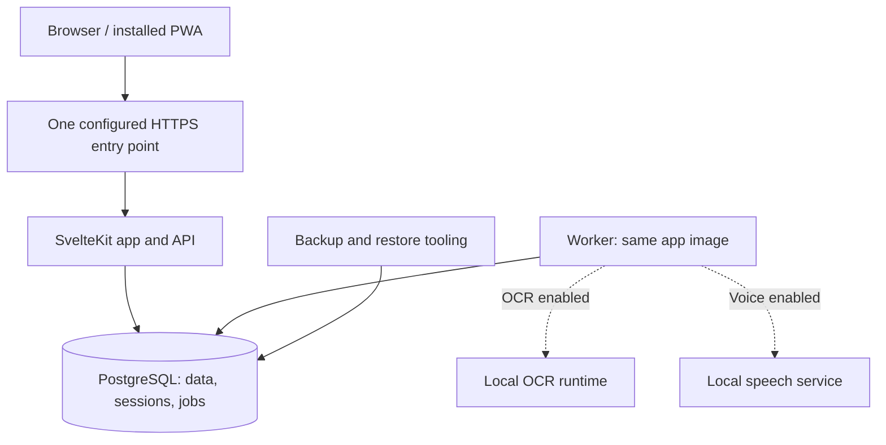

# obur — Product and technical design

> Canonical design document, maintained in the repository. Revised: 2026-10-25 (owner edits reviewed and reconciled; UI direction recorded).
> `CLAUDE.md` describes how to work; this document defines the product, data rules, architecture and release gates. Planning conversations inform changes here; they are not a second source of truth.

## Direction and decision status

**obur** (Turkish: gluttonous, someone who eats a lot) is a self-hosted calorie, weight and water tracker intended to replace LoseIt. It is a mobile-first, installable web app with an English interface and English, Turkish and mixed-language input. Food names retain the exact spelling entered. Licence: MIT.

A typical installation serves a household or close circle, roughly ten people or fewer, without a hard account limit. Accounts are always invite-only. The owner chooses product behaviour; the implementation agent makes routine technical decisions and explains consequential trade-offs plainly. LoseIt is an import source and inspiration, not a specification to copy.

Decisions have three statuses:

- **Committed:** product direction, privacy boundaries, data integrity rules and the core stack below. Change them explicitly in this file when agreed.
- **Provisional:** choices that need real data, hardware measurements or user experience evidence. State the assumption and the test that will settle it. A target is not a measured result.
- **Deferred:** useful features that are outside the first daily-use release. Do not build their infrastructure in advance unless a current feature needs it.

The risks to investigate early are import fidelity, quantity and nutrient semantics, phone usability, speech/OCR quality and latency, account recovery, offline queues, and recovery from server failure. None is proven by selecting a library.

## Scope and first usable release

The first release must make an ordinary day easy: find or create a food, choose a supported amount, save it to the intended day and meal, correct it, and understand the totals. Weight and water are quick manual entries. Logging must remain fully useful when speech and OCR are disabled.

**First daily-use pilot includes:** one deployment route, passkeys and invitations, user isolation, a small private/shared catalog, search and recent foods, calories-only quick add, diary edit/delete/undo and a Move to menu, weight and water, onboarding with BMI and an estimated base burn, a versioned daily budget (base burn plus manually entered activity calories, minus the goal's deficit), basic daily totals and weight history, a usable mobile interface, portable export/import for the implemented data, account deletion, and rehearsed encrypted backups. Historical LoseIt migration is a separate gate before the owner replaces LoseIt.

**Early follow-up:** a verified LoseIt importer, a curated generic-food import, saved meals, and a narrow typed/voice flow for actual favourite foods. Voice is a priority to evaluate early, not something postponed until all decorative features exist.

**Later:** recipes, production label OCR and barcode capture, advanced charts, a timeline, achievements (including one for every kilo lost), reminders, drag-and-drop and bulk diary actions, full offline editing, additional deployment profiles, an Unraid template, and catalog exchange between installations. These remain planned capabilities; they are not prerequisites for trying the core diary.

**Not in v1:** native apps, Apple Health/Health Connect integration, meal planning, grocery lists, social features, shared diaries or coaching. Native apps are unlikely and must not drive current architecture. A future Health integration would require a separate feasibility and product decision.

**Never planned:** open registration, billing or multi-organisation tenancy. Do not build for them or add special machinery to prohibit them.

## Architecture and stack

One modular TypeScript application and one PostgreSQL database, shipped through Docker Compose. The application image can run web/API and background-worker commands. Start optional services only when the corresponding feature is enabled.

| Component | Choice | Status |
| --- | --- | --- |
| Web and API | SvelteKit, Svelte 5, Node, strict TypeScript | Committed |
| UI and validation | Tailwind CSS, Valibot, one English message catalog using Paraglide | Committed |
| Database and jobs | PostgreSQL, Drizzle ORM, pg-boss; no Redis | Committed |
| Authentication | WebAuthn through SimpleWebAuthn server/browser packages | Committed |
| Charts | LayerChart when richer charts are introduced | Planned |
| Label OCR | PaddleOCR PP-OCRv6 small (detector and recogniser) through ONNX Runtime on images of about 1280 px, followed by a rule-based table parser | Model chosen from Phase 0 measurements (`docs/feasibility.md`); parser and end-to-end evaluation still needed |
| Speech | faster-whisper `small` (int8) in its own Python container | Chosen from Phase 0 measurements (`docs/feasibility.md`); confirm on held-out recordings before release |
| Language-model fallback | A small local LLM through Ollama, off by default | Deferred until failures justify it |
| Backups | pgBackRest: encrypted local repository required; off-site repository optional per installation (Cloudflare R2 for the owner's pilot) | Committed before production use |
| Entry point | Cloudflare Tunnel for the owner's pilot; Tailscale Serve and Caddy profiles later | Pilot route decided; hostname and RP ID live only in `.env` |

The worker claims durable jobs from Postgres. Upload and job payloads have bounded sizes and lifetimes. Jobs carry authenticated ownership, use the same isolation rules as requests, and are safe to retry. OCR and speech have separate bounded queues/concurrency so a long scan cannot indefinitely block a short voice clip or ordinary database work.

### Module boundaries

Modules live under `src/lib/server/modules/`. Add them when their functionality arrives; do not scaffold empty layers for every future feature.

| Module | Responsibility |
| --- | --- |
| `auth` | Passkeys, invites, sessions, recovery |
| `catalog` | Foods, servings, recipes, aliases, curated food import |
| `diary` | Entries, meals, saved meals, moves, trash and queued-create ingestion |
| `body` | Weight, measurements, water and recorded activity |
| `goals` | Versioned targets and, later, explicitly specified target calculations |
| `label-parser`, `nl-parser` | Pure text/geometry-to-proposal functions with explicit inputs |
| `ocr` | OCR runtime adapter and scan jobs |
| `imports-exports` | Import staging, identity reconciliation and portable data archives |
| `progress` | Chart queries and, later, timeline/achievement rules |
| `admin` | User administration and backup/restore status |

Each module exposes a small public API and owns its writes and tests. Enforce import boundaries with linting. Cross-module operations share an explicit transaction context; imports must not become partly committed because each module opens its own transaction. Reporting queries may use documented read interfaces/views that retain RLS rather than requiring a chain of per-row calls. Migrations use one ordered application-level sequence, with ownership documented by module.

Parsers do not perform database or framework I/O. Inject clock/date context, user units and candidate data as needed; an application service resolves food matches and validates permissions. Routes remain thin. JSON endpoints used by the PWA/imports live under `/api/v1`; client-generated record IDs and operation IDs serve actual retry/offline needs.

Keep sessions and jobs in Postgres, index real access paths, paginate long lists and make worker concurrency configurable. These are enough for the intended scale; replication, microservices and generic multi-tenant frameworks are unnecessary.

## Deployment, network and maintenance

The owner's pilot runs on a home server behind Cloudflare Tunnel, on a subdomain of the owner's own domain. The WebAuthn RP ID is the parent domain, so moving obur to another subdomain later keeps everyone's passkeys. The real hostname and RP ID are recorded only in the owner's `.env` and private notes, never in the repo. Implement and test this one route first; Tailscale Serve and Caddy profiles come later for other installs. Public URL, RP ID, allowed origin and feature flags come from configuration, never real hostnames in source control.

Changing an RP ID generally requires credential re-enrollment; treat hostname migration as a migration project, not a harmless `.env` edit. Local development uses `localhost`; real-phone tests use a separate HTTPS development origin and accounts, preferably `tailscale serve` on the development PC so the test build isn't public. Trust client-IP headers only from the configured proxy path, with direct application access blocked.

No telemetry, external food/product queries, remote inference or outside error tracking. Nutrition photos, audio and transcripts are processed locally. Explicitly configured infrastructure is a separate boundary: an entry-point provider, encrypted off-site storage, and later opt-in Web Push or notification delivery can contact outside services. Document the provider and data sent; keep reminder payloads generic. Do not describe a provider-mediated deployment as making no third-party connections. Model/catalog downloads happen during setup or deliberate updates, with version and licence recorded.

OCR and voice are independently disabled at the UI/API/job boundaries; disabling voice also stops the speech container. Core logic does not scatter feature-flag checks. No generative vision model is planned for labels; OCR itself uses trained models. Browser OCR and Whisper fine-tuning are deferred, not promised improvements.

Publish versioned app images from CI on tagged releases. Pin supported Postgres and model/runtime versions. Dependency updates are reviewed with tests and release notes; green CI is necessary but not automatic permission to merge. Do not auto-update production containers. Structured JSON logs omit credentials, raw health records and unnecessary transcripts; configure rotation and retention. Healthchecks distinguish process health from readiness. Upgrade and rollback ordering are defined in the data-safety section.

## Mobile interface and design process

obur should feel joyful to use without ever being slower to use. Practical first, fun second, and the fun lives in small moments, not in the layout.

- **Cohesion:** one design system (colours, type, spacing, components) used everywhere; no one-off screens.
- **Joy in moments:** a satisfying tick when something is logged, a proper celebration for each kilo lost, friendly copy, a confident palette. Animations are short, never block input, and respect reduced motion.
- **Calm everyday screens:** nothing decorative between the person and logging food.
- **Density where it helps:** numbers and lists compact and scannable; anything tappable stays large.
- **Mobile first, desktop as good:** desktop gets its own layouts (side nav, two columns), not a stretched phone.
- **Modern conventions** over novelty.

**Process:** a few distinct visual directions are built as clickable demos for the core Today and Log flows, phone and desktop, light and dark, filled with real long Turkish food names. The owner picks one and it's refined together, for example in the Claude app. The chosen direction is recorded in `docs/ui.md` and reusable tokens in the repo, so it doesn't depend on any external conversation. **Chosen direction: Pazar** (2026-10-25); `docs/ui.md` is authoritative on visual and interaction matters, with the reference demo in `docs/ui/`. After that, add tokens/components as screens require them, documenting additions without seeking approval for every spacing decision.

- Phone-first layouts, then useful wider layouts; initial navigation is Today, Log, Progress and Profile.
- Light and dark themes, WCAG AA contrast, accessible names, keyboard operation, 200% text resizing, reduced motion and safe-area insets. Web touch targets are at least 44 by 44 CSS pixels.
- Prioritize search and fast repeat logging. Recent and favourite foods appear as suggestions when the search field is focused and empty; there are no standing Recent/Favourites lists (owner's UI decision, `docs/ui.md`). Speak and Scan are tiles in the core Log screen. Until each feature is implemented they appear disabled and labelled "Coming soon" (owner decision, 2026-10-25); once implemented they are hidden when switched off in configuration. Nothing decorative blocks entering or correcting a meal.
- Every drag action eventually has a menu equivalent. Menus ship before drag-and-drop.
- Stable deep links open supported actions pre-filled but never write data by merely opening a URL. A button or explicit confirmation performs the write.
- PWA manifest shortcuts and optional Apple Shortcuts are later conveniences. Verify actual routing, authentication and installed-app behaviour on the supported phones; do not assume Safari and the installed app share sessions or that links open the desired surface.
- Camera, barcode scanning, microphone permission and recording formats require real-device checks. Browser viewport emulation does not establish phone hardware compatibility.
- Reminders are deferred, per person, opt-in, and include quiet hours. Check current platform support when implementing them.

## Diary and logging rules

An entry belongs to the diary date and meal selected by the person, not the upload time. Store an explicit local diary date, IANA time zone, optional eaten/measured time, creation time and server modification revision. Weight, water and activity also retain the intended local day so backdating, travel and delayed uploads behave consistently.

Default to the day being viewed. For a Today/log-now shortcut before a configurable cutoff (initially 04:00), offer the previous diary day without silently changing a deliberately selected day. Resolve spoken relative dates using the captured local context and show the resolved date in confirmation; a retry tomorrow must not reinterpret yesterday's phrase.

Each diary entry stores a self-contained snapshot: food name/brand, amount and basis, serving conversion and its provenance, nutrient values/qualifiers, source, and any explicitly accepted estimate. Later food edits, merges and deletion cannot rewrite it. Editing an old amount uses that entry's snapshot; applying newer food information is a separate explicit action.

Manual food selection and save is already a confirmation; do not add a second modal to routine logging. Parsed voice/text/scan proposals require an editable confirmation showing food, quantity, unit, day, meal and warnings. Nothing is saved in the background from interpretation alone.

Calories-only entries accept an explicitly provided number and optional description, with other nutrients unknown. The rule against invented calories applies to inferred food matches, not to an explicit statement such as "300 kcal snack". Activity, weight and water likewise use the confirmed numeric input.

Ship edit, delete/undo and Move to first. Add copy meal/day, multi-select, saved meals and drag-and-drop incrementally. Copying uses stored snapshots unless the user chooses to refresh the foods. A saved meal stores its own snapshot of each item, like diary entries; refreshing it to current food values is an explicit action. Logging it creates ordinary editable entries.

## Data model and nutrient contract

The following is a logical model, not a demand to create all tables in the pilot. Final names and indexes follow actual queries. Shared reference data and authentication bootstrap tables need deliberate access policies rather than a blanket ownership rule.

| Entity | Key data and invariants |
| --- | --- |
| Users and preferences | Identity, role, units, time zone; only collect profile measurements needed by enabled features |
| Credentials, sessions, invites, recovery tokens | Explicit owner/issuer, token hashes where applicable, expiry/revocation; no passwords |
| Foods | Stable ID, owner or curated-system ownership, private/server visibility, name/brand, nutrient basis, source nutrient definitions, reported values, serving conversions, provenance, optional barcode, archived/deleted status, row version |
| Food revisions (later, with recipes) | Immutable versions of a food so recipes can pin ingredients; the pilot relies on snapshots instead |
| Servings and household measures | Portion name, quantity and supported g/ml/count conversion; no implied mass for an unweighed portion |
| Recipe revisions and ingredients | Pinned ingredient revisions/amounts, total nutrients, optional measured cooked yield, serving count |
| Favourites and aliases | Per-user links; reviewed shared bilingual aliases are distinct from personal corrections |
| Diary entries | Owner, intended day/meal, amount, independent snapshot, optional food reference, revision and deletion state |
| Weight, water, measurements, activity | Owner, intended local date/time, metric amount, source identity, revision and deletion state |
| Targets and daily budgets | Effective dates, calculation version/inputs or manual target, activity-credit policy, frozen historical values |
| Saved meals | Owner, named list of item snapshots and amounts |
| Import batches and source records | Owner, format/version, file hash, stable source identity or row fingerprint, reconciliation decisions and outcome |
| Queued operations | Owner, unique operation/record ID, payload fingerprint and durable result for safe retries |
| Scans and parser cases | Owner, OCR/transcript and structured proposal/correction, retention/consent; no persistent production media |
| Day completion | Owner, intended local date and when it was marked complete; LoseIt's daily `Complete` markers import here |
| Later features | Achievements, timeline, notification settings, sync tombstones/cursors as required |

### Quantities and source values

Support three nutrient bases: **per 100 g**, **per 100 ml**, and **per named serving/count** when mass or volume is unknown. Preserve the original basis and serving quantity. A serving-only food cannot be logged in grams until a justified conversion is supplied.

Never assume 1 g/ml. A volume-based food can use volume portions directly; a mass-based food needs a food-specific mass per portion or known density. Missing conversions trigger a question or a supported-unit choice. Any user-entered estimate is explicit and retains its provenance in the snapshot.

Household measures are named portions, not universal physical units. Seed commonly used volume presets such as su bardağı 200 ml and yemek kaşığı 15 ml, clearly editable. Seeded in Phase 1: su bardağı 200 ml, çay bardağı 100 ml, yemek kaşığı 15 ml, tatlı kaşığı 10 ml, çay kaşığı 5 ml (volume only; an admin editor comes later). Do not assign an arbitrary universal bowl size. Distinguish US/imperial cup and fluid-ounce definitions in settings and import mappings. Store physical quantities in metric; count-based servings remain counts. Convert only at input/display boundaries with defined decimal precision and rounding.

Each nutrient preserves its source identifier/definition, unit, reported numeric value and qualifier (`as-reported`, `less-than`, `derived` or explicit estimate). Missing is null. Do not turn `<0.5 g` into 0 or 0.25; retain the bound and show it. Arithmetic propagates bounds/estimates, and totals show partial coverage when a contributing value is unknown. Zero means reported zero, not an omitted field.

### Mixed-source nutrition

The interface supports energy, fat, saturated fat, carbohydrate, sugars, fibre, protein and salt, plus source-provided extras. Not all sources supply every nutrient. Energy from the source/confirmed label is retained; macro arithmetic is diagnostic, not a replacement for it.

USDA carbohydrate-by-difference includes fibre; EU-style reported carbohydrate is a different definition. Store total-carbohydrate and carbohydrate-excluding-fibre meanings separately. Never sum them into one field without a conversion policy.

For a consistent dashboard, use carbohydrate excluding fibre. EU-style values map directly when their source definition matches. A total-minus-fibre value may be derived from compatible USDA/US fields as an **estimate**, with the original values retained; missing fibre or inconsistent/negative results leave that derived field unknown and require review. Display derived/partial status and preserve the source's reported total carbohydrate in food details and exports. Confirm the exact nutrient-ID mapping against the dataset version before import. This convention is not a claim that a difference calculation is a laboratory measurement of available carbohydrate.

Salt derived from sodium uses explicit mg-to-g conversion and a documented factor, retaining the original sodium. Calories/kilojoules retain original values and derived-display provenance. Source schema, dataset release and mapping version accompany imported data.

Reference: [USDA Foundation Foods documentation](https://fdc.nal.usda.gov/Foundation_Foods_Documentation/) and [EU nutrient definitions and energy factors](https://eur-lex.europa.eu/legal-content/EN/ALL/?uri=CELEX%3A32011R1169).

## Food catalog and recipes

The local catalog combines curated generic foods, private imported foods, confirmed scans and manual entries. There are no runtime external product lookups. USDA Foundation Foods and SR Legacy are candidate sources for generic foods; verify field coverage and dataset versions, import a useful subset first, and avoid importing US branded foods by default.

Foods people create by hand and confirmed label scans are shared on the server by default, with a private option when adding one. Foods imported from LoseIt are private by default, because years of imported foods reveal more about a person's habits than any single product; the import preview offers sharing all or selected foods. Sharing publishes only food content, never diary links, usage times or who logged it. A curated shared catalog remains available for discovery. Shared API responses omit personal attribution/provenance that is not needed to use the food.

**No automatic copy on first use.** A user can log an accessible shared food directly; the diary snapshot preserves history. Only its creator or an admin edits it; only the creator can change who can see it (an admin cannot make someone else's food private). Edits carry the version they were based on and a stale edit is rejected rather than overwriting. Foods are archived, never deleted, through the app. Hand-made foods must state energy (kcal or kJ); imports may lack it. Someone wanting different values chooses "Make my own variant", which creates a private copy that records where it came from. Future selections use the food's current values, while saved meals keep their snapshots until explicitly refreshed. No update-notification system is required for the pilot.

Barcode and normalized name/brand suggest duplicate candidates; they do not prove identical formulation or serving basis. Never silently overwrite values or merge distinct imported foods because names match. An admin can merge duplicates; search then points to the kept food, and diary snapshots are untouched. Archive superseded products; a barcode can match several foods (for example after a formulation change), shown for the person to choose.

Search prioritizes recent/favourite foods, the user's private foods, then shared references. Implemented (Phase 1): every query word must appear in a folded brand-and-name key, in any order, or the whole query must be trigram-similar (typos); real matches come before typo matches, and within each the person's own foods come first; recent foods join the ranking with the diary. Preserve original spelling; use Unicode normalization, Turkish-aware casing for Turkish matching and transliteration-aware search so `sutas` finds `Sütaş`. English and mixed text need test cases too; do not apply Turkish casing blindly to every language. Shared EN→TR aliases start with a small reviewed useful set and grow from real searches. Learned corrections remain per-user and can be edited/deleted.

Recipes introduce food revisions: they pin ingredient versions and explicit quantities, including valid volume or serving quantities. Sum ingredient nutrients with unknown/derived flags propagated. A recipe can be logged by a declared serving count; per-100-g cooked nutrition is available only with a measured or explicitly entered cooked yield. Do not infer cooked yield from raw ingredient mass. Disallow circular recipe dependencies.

Sharing a recipe requires every exposed ingredient revision to be shareable; offer a flattened public food with totals when the author wants to keep ingredients private. Deleting/privatizing a source food must not leave broken recipe permissions: retained snapshots support existing recipes, but no new lookup may expose private source data. Account-deletion rules govern previously shared revisions.

Catalog export/import between installations is deferred. When added, export only authorized shared foods plus their necessary public dependencies; preserve versions where they exist and show duplicate candidates instead of destructive automatic merges.

## LoseIt import and migration fidelity

Inspect an actual owner-supplied export in phase 0 before finalizing schema assumptions. Record the actual files, headers, date/time conventions, units, stable identifiers, nutrient coverage and recipe/exercise gaps in a fixture/schema note. Do not promise that a third-party description or a particular subscription/export route matches today's product. Keep real health history out of the public repository; use a redacted fixture preserving edge cases.

1. Detect a supported version from headers and validate file/archive limits. For unknown layouts, explain the mismatch and stop before writing; a general column-mapping UI is deferred.
2. Stage and validate the whole import, including dates, quantities, missing masses and source nutrient definitions. A serving-only item stays serving-only. Preserve source values rather than reconstructing them from today's catalog.
3. Preview new, unchanged, changed, ambiguous and rejected records, date range and daily totals. Never silently discard errors. Hash the file per user/source to recognize exact repeats.
4. Reconcile overlapping exports using source entry IDs where available. Otherwise use a documented fingerprint plus occurrence/multiplicity handling, preserving legitimate repeated identical meals. Changed or ambiguous historical rows require an explicit preview decision; a fingerprint is not proof of identity.
5. Commit approved database changes and import identities together in one transaction. Revalidate relevant versions/permissions at commit so an old preview cannot apply blindly. A failure leaves no partial history or catalog mutations.
6. Imported foods are private by default (see Food catalog); match source IDs and content, not only name/brand/serving. Entries retain the exported nutrient snapshot. Exercise values retain their source meaning and do not automatically increase a budget until that meaning is understood.
7. Reconcile counts and daily calorie/nutrient totals to the source, with explicit tolerances only for documented rounding. Preserve unavailable data as unknown. Retain the original export independently until migration is accepted.

**Phase 2 implementation (2026-10-30).** LoseIt rows have no IDs: a row's identity is its exact content plus its occurrence among identical rows, so legitimate repeats stay separate and an overlapping export adds only rows not seen before. Rows imported earlier but missing from a newer export (deleted or edited in LoseIt) are counted in the preview and moved to the trash only if the person ticks that option. Diary rows keep LoseIt's totals in their own snapshot and link to a custom food only when exactly one has that name. LoseIt database foods become private foods from their latest diary row. Carbohydrate is stored as `carbohydrate_unspecified`. Budgets become manual target versions from each date they changed, only before the first target set in obur. Activity is recorded with `counts_toward_budget = false`. Weight unit and time zone come from the preview. Serving definitions and recipes are not imported yet.

The replacement gate includes exact-repeat and overlapping-export tests, repeated identical meals, changed rows, unknown serving weights, decimal commas, date boundaries and an export/import round trip. Known export omissions are reported to the owner; do not fabricate recipe ingredients or promise full fidelity for fields the export lacks.

## Offline scope and synchronization

The pilot supports cached viewing and queued **new** diary, weight and water entries. Offline creation uses cached accessible foods and known conversions, or explicit manual/calories-only input. OCR, speech processing, catalog changes, imports, and editing/deleting already-synced records require a connection initially. Users can edit or discard a local unsent draft. Pending records are visibly pending, not reported as saved to the server.

- Every create carries a client-generated record ID, operation ID, owner binding, immutable proposed payload and captured date/time-zone context. The server derives identity from the session, never trusts a submitted `user_id`.
- In one transaction, validate access/units, create the record and store the operation outcome. Replaying the same operation returns the same result; reusing its ID with different content is a conflict. A submitted operation is not rewritten while its outcome is uncertain.
- Keep accepted IDs/deletion markers sufficient to prevent a late retry from recreating a deleted row. Payload details can expire earlier than the minimal deduplication record. Deleted accounts cannot submit old queues after re-enrollment as a new identity.
- If a food or permission changed while offline, keep the local draft and request review. Do not silently substitute current food values or apply a new conversion.
- Retry on foreground/reconnection; do not depend on background sync running on every phone. Expired sessions pause sending and require login to the same account. Storage eviction or clearing browser data can lose unsent drafts; the UI distinguishes local-only data from server-backed history.
- Partition IndexedDB/caches by account. Never send one account's queue as another user. Clear sensitive caches on sign-out; if unsent drafts exist, explicitly offer to reconnect/sync before signing out or discard them. Disable/revoke access on the server even if an offline device still has a local copy.

**Phase 1 implementation (2026-10-26).** One IndexedDB queue per account (`obur-queue-<user id>`), sent strictly in creation order; a new entry waits behind older ones. Unreachable is inferred from a failed request, a 10-second timeout or a 5xx answer, never from `navigator.onLine`. Sending happens on load, on the `online` event, on return to the foreground and every 30 seconds while something waits. A 401 pauses sending and asks the same person to sign in again; any other refusal keeps the draft for review. Unsent drafts can be discarded; editing a draft is done by discarding it and entering it again (provisional). The service worker serves the app shell cache-first and signed-in pages, their data and a few read-only API responses (food detail, recent foods, measures, a diary day) network-first with the saved copy as fallback. When a page shows the saved copy, it says so and refreshes at the next send attempt. Owner's iPhone test (2026-10-29) led to: a 3-second limit when someone taps Save (background sends keep 10 seconds), and after a failed request new entries go straight to the queue for a minute, because iOS can leave offline requests hanging; sheets close before their confirmation shows; the app saves a copy of every main tab and its data in the background once per start, so tabs never opened online still open offline; hashed code files are matched ignoring `Vary` (a module import sends an Origin header the install-time copy lacked, so page code was never found offline); the previous version's code stays cached, so a page opened before an update keeps working offline; a confirmation survives a full page reload. The root cause on the iPhone was Cloudflare caching the service worker file (`.js` is cached by default): the stale worker listed files that later builds no longer had, its all-or-nothing install failed, and the app had no offline support. The production server (`server.js`) now sends `Cache-Control: no-store` for the service worker and the manifest, and the install caches file by file. The same server is used by the browser tests. The service worker has the same one-minute memory as the queue: after a failed or timed-out request (3 seconds), pages and their data come from the saved copy at once, while the network is retried in the background. A saved page is refreshed only when something arrived or a quick check (bypassing saved copies) reaches the server, because a failed refresh makes SvelteKit reload the whole page. A page that reads its own query (Log) is served from its plain saved copy; any other page never saved shows a "Not available offline" page instead of another page. Offline food search says it needs a connection and offers quick add. Sign-in pages and all writes always use the network. Saved pages are cleared on sign-out and when a different person signs in on the device. The worker purges trash older than 30 days nightly through a reviewed SECURITY DEFINER function, leaving a minimal marker (ID, owner, kind, time) in `purged_records`; a create that reuses a purged ID gets `410 gone`, and the offline queue then drops that item.

Online edits use server revisions and expected-version checks. A stale edit gets an explicit conflict response; client clocks do not determine the winner.

**Full offline editing is deferred.** Its prerequisite design must cover revisions, conflict choices, deletion tombstones beyond the 30-day undo window, explicit restore versus stale edit, sync cursors, maximum supported offline age, and full resynchronization for older clients. "Latest edit wins" is not the policy. Implement and test those cases before expanding the offline scope.

## Targets, profile and activity

**Onboarding** asks for height, weight, birth date and sex (the formulas need them), optionally body-fat % and waist. It shows BMI (kg/m²) with WHO adult categories, waist-to-height ratio when waist is given, and a note that BMI can't tell muscle from fat. None of it is presented as a diagnosis, and onboarding ends with a short note that targets are estimates, not medical advice. A person can also skip all of this and set a target by hand.

**Base burn** is what the body uses on a day with no physical activity: BMR (Mifflin–St Jeor by default, Katch–McArdle when body-fat % is known) times a sedentary factor of about 1.2, which covers ordinary daily living. A person can replace it with a fixed number they choose.

**Daily budget = base burn + calories burned through activity that day − the goal's deficit.** Example: base 2,000 kcal plus 1,000 kcal burned, with no deficit, gives 3,000 kcal.

- A hand-set target is treated as the budget for an inactive day, so counted activity is added to it as well (implementation decision, Phase 1).
- Activity is entered by hand as calories burned, with an optional note. The interface states its meaning plainly: extra calories above a normal inactive day, not a watch's total for the day. No workout types, durations or exercise library.
- Activity whose meaning isn't clear, such as LoseIt's imported exercise values, is recorded with its source and shown, but not added to the budget until its meaning is mapped and confirmed.
- Goal weight and rate, from maintain to 1 kg/week; the deficit uses about 7,700 kcal per kg, capped at 1% of body weight per week. Budgets never drop below an editable floor (initially 1,500 kcal for men, 1,200 for women). These are estimates and guardrails, not guarantees of safety or exact forecasts.
- Macros: protein from body weight, fat as a share of calories, carbs the rest; all editable. Implemented defaults (provisional, owner to confirm): protein 1.2 g per kg of goal weight when a lower goal is set, otherwise current weight; fat 30 % of the day's budget; carbohydrate the remainder (never negative). Macro targets exist only for calculated targets.
- Targets are versioned by effective date and each day keeps its final budget and inputs. Changing weight, settings or formulas never rewrites past days; a deliberate historical correction creates an auditable new version. The app suggests recalculating after a few kilos of change (implemented: 3 kg since the version's weight). Implementation: target versions are append-only rows storing the computed numbers and inputs; a day's budget is the newest version effective on or before it plus that day's counted activity.
- Formulas are covered by fixture tests with published worked examples.

Do not automatically apply adult target/BMI calculations to minors, pregnancy or breastfeeding by just switching the deficit off. For these states, support logging without algorithmic calorie or weight-loss targets; professionally provided targets may be entered explicitly. A dedicated supported calculation path would need separate review. For these states BMI uses no adult categories and no weight-loss suggestion is shown. [NIDDK likewise limits its planner's intended population](https://www.niddk.nih.gov/health-information/weight-management/body-weight-planner).

Units are per person: body weight, height, food mass/volume, energy and water, plus date format and first day of week. Preserve count-based portions, specify cup/fl-oz systems, and accept decimal commas and dots without ambiguous thousands-separator guesses. Collect birth date/sex/body-fat data only if an enabled feature actually needs it.

## OCR and barcode capture

The candidate pipeline is capture/crop → local OCR with positions → table parsing → diagnostic checks → editable confirmation. The name and brand are entered manually; OCR focuses on the nutrition table and serving size. Decode a barcode separately when necessary; a nutrition close-up may not contain it. Verify camera focus/crop/glare guidance on real phones rather than promising unavailable camera controls.

A known barcode offers existing products and a rescan option; formulations can change. An unknown barcode does not trigger an external lookup. The parser identifies row labels, per-100-g/ml or per-serving basis, columns and qualifiers; it must distinguish amount columns from %RI/%DV and avoid merging multilingual duplicates.

Checks include sugars versus carbohydrate, saturated versus total fat, compatible serving/100-unit ratios, sodium/salt conversion, and source-aware mass/energy consistency. Energy arithmetic accounts for source definitions and known contributors such as fibre/polyols/alcohol where provided; missing information is not a zero. Rounded labels can disagree. Checks produce warnings, never silently repair source values or prove the selected column is correct. Do not reject a legitimate food solely because a simplified 4/4/9 check fails.

Show the cropped photo next to the editable proposal. Keep production media only until confirmation/cancellation, with a bounded cleanup TTL for abandoned/failed jobs. Production photos never enter backups. Store only the necessary confirmed values and, with retention controls, OCR text/positions/corrections for private parser cases.

## Typed and voice logging

Voice fills the same text-to-entry workflow as typed input. Start with food + amount + supported unit + day/meal for common foods, plus explicit calories-only entries. Then extend to activity, weight, water and mixed intents, using a tagged proposal schema rather than pretending every result is a food.

The pure parser recognizes English/Turkish numbers, comma decimals, units, meal words and relative dates. The matching service resolves accessible foods using recent/favourite/private/shared candidates. Ambiguous foods, dates and missing portion conversions require a choice. Food nutrients come from the selected food; the parser/optional LLM never invents them. Explicit kcal/weight/water/activity values are permitted inputs.

Record in the browser and transcribe locally. Phase 0 selected faster-whisper `small`: on the target server it came within two points of large-v3-turbo's accuracy at under half the latency, while large-v3-turbo could not meet the latency target (`docs/feasibility.md`). Restrict language detection to Turkish or English (unrestricted detection produced a wrong-language, 35-second failure), prompt with the person's frequent foods and brands, and decode once at temperature 0 to bound processing time. Re-evaluate on held-out recordings, including another speaker, before release; keep the chosen model loaded and bound clip duration, queue length and concurrency. Vocabulary prompts and fuzzy matching are experiments, not guarantees of bilingual brand recognition. Preserve the original transcript for the confirmation flow, allow correction, and present a single editable result rather than requiring a separate mandatory transcript-approval screen.

Examples include "100 g Sütaş ayran", "Öğlende bir tane muz yedim", "300 kcal snack", "iki gün önce 450 kalori yaktım", "bugün 82,4 kiloydum" and "iki bardak su içtim". Dates/units are explicit on confirmation. Learning an alias from a correction is per-user, reversible and must not change another user's matching.

Production audio is deleted after transcription, or on failure/cancellation after a bounded TTL. Saving transcript/correction pairs as regression cases is opt-in with deletion/retention controls. Separately consented recordings made specifically for testing live outside the production app and public repo; they are necessary to test speech-model changes, while transcript fixtures test the parser alone.

## Evaluation and acceptance criteria

Phase 0 is an initial risk investigation, not a promise that two days proves a complete bilingual system. Use the same model versions, preprocessing and representative settings on development and target hardware; quantization/runtime choices can affect quality as well as speed. Record hardware, model/runtime versions, memory and concurrency alongside measurements.

**Initial evaluation data:** about ten hand-checked real label photos, growing toward thirty or more varied labels; around fifty reviewed typed sentences across English, Turkish and mixed input; a small separately consented recording set; actual anonymized import fixtures; and representative daily meals/recipes/servings. Include curved packs, poor light, multiple columns, serving-only labels, bounds, decimal commas and deliberately ambiguous input.

Separate development cases from held-out evaluation cases. Report sample counts and failure categories; do not generalize from a tiny corpus. Confirmed production corrections can extend a private parser regression set with permission, but do not become independent held-out evidence merely by being replayed.

| Area | Measure | Gate |
| --- | --- | --- |
| Core logging | Time/taps to find a recent food, save it, correct amount/date; recurring meal workflow | Provisional goal: a familiar single-food entry within 10 seconds and a correction within 3 actions on the owner's phone; validate usability, then record accepted targets |
| Imports | Counts, identities, dates, quantities and daily totals versus actual source | No unexplained missing/duplicate records or nutrient changes; documented rounding only |
| OCR | Field accuracy, exact basis/column selection, complete-label zero-edit rate, serious numeric errors and correction time | Retain 98% field accuracy as a development target, not a standalone release gate; every known severe unflagged error must be resolved before release |
| Voice | Food/amount/unit/day/intent correctness, corrections and time to confirmed entry | Compare against manual logging; decide acceptable correction rate from representative recorded results before shipping |
| Latency | Full upload/queue/process/match-to-editable-result time, p50/p95 when sample size supports it | Provisional warm targets: voice p95 at most 5 seconds after a short clip ends; OCR p95 at most 10 seconds from submitting the captured image, including upload; cold start and contention reported separately |
| Phone behaviour | Installed PWA login/recovery, camera, recording, local queue and reconnection | Pass on actual supported devices; no viewport-only claims |

The latency/usability numbers are proposed acceptance targets, not published hardware capabilities. Owner experience and initial measurements settle them before release claims. Measure on the target 2-core/4-thread i3 with 16 GB RAM and record the exact CPU/storage; do not publish minimum RAM or speed claims before a full-stack measurement. If targets fail, reduce the model, simplify the supported flow or keep the feature experimental/off. Manual logging work can continue independently.

## Progress, graphs and optional encouragement

Start with daily totals and a basic weight-history view. A day counts as under budget, and is shown green in the calendar, only after the person marks it complete; a logged but incomplete day is shown neutrally, so forgetting to log is never rewarded. Missing days are unlogged, not zero intake; missing weigh-ins remain missing. A "same value" shortcut still records a genuinely measured reading and must not fabricate an observation. Distinguish an observed zero from no activity/water record where relevant.

Later charts can show raw weight and a documented smoothed trend, calorie/budget comparisons, partial nutrient totals and water targets across common ranges. Specify how smoothing treats gaps; forecasts are estimates and require adequate data. Timeline and richer charts use the same historical snapshots as the diary.

Achievements celebrate progress, the headline being **one for every kilo lost**: awarded the first time a weigh-in reaches start weight minus n kg, once only. Others: percentage milestones, goal reached, logging streaks and firsts (first scan, first voice log). Weight-loss celebrations are disabled for unsupported populations and maintenance/no-loss goals. Do not reward "under budget" without a user-marked complete day and an explicitly reviewed rule; incompletely logged days cannot qualify. Define how corrected/deleted source records invalidate erroneous awards, while ordinary weight fluctuations do not repeatedly grant the same milestone. Backfills use the event's intended date.

## Security and authentication

Normal sign-in is passwordless WebAuthn and accounts are invite-only. Application authorization and Postgres row-level security work together; RLS limits accidental cross-user access but does not protect against a compromised application supplying a false user identity or a server administrator reading the database.

**Passkeys and recovery**

- Use `@simplewebauthn/server` and `@simplewebauthn/browser`; accept platform passkeys and roaming security keys with user verification required.
- Allow multiple credentials. Recommend two independent ways to recover access, such as a passkey and a security key, rather than blocking first use until a second key is enrolled.
- Normal credential management, personal export and account deletion require a fresh passkey assertion. A recovery session is a narrow, explicit exception that can enroll a replacement credential; it cannot export data or act as an ordinary signed-in session.
- Member recovery uses a one-time recovery code or a short-lived re-enrollment link issued by a freshly authenticated admin. Recovery codes and link tokens are high entropy, stored as hashes, rate limited and consumed atomically once.
- Admin recovery links are issued only by an operator command on the server: `npm run admin:recovery-link -- "<display name or user ID>"` (one hour, single use). The first admin's setup link likewise comes only from `npm run admin:setup-link` (24 hours, single use, refused once any account exists). There is no unauthenticated web endpoint that issues a reset. Links carry their token in the URL fragment, which browsers never send to the server, and the page removes it from the address bar before use. The issued link is redeemed through a narrowly scoped HTTPS enrollment flow.
- Successful recovery revokes existing sessions, old credentials and unused recovery tokens, enrolls the replacement credential, and issues a fresh set of recovery codes. The confirmation explains this before proceeding. A still-working passkey uses normal credential management instead.
- A bootstrap token creates the first admin once and then becomes unusable. Setup and recovery tokens must not appear in ordinary access logs, analytics, browser referrers or subsequent page URLs.
- Defer a hardware-only account policy. An AAGUID alone is not proof of trusted hardware; any later implementation needs a supported, verified attestation policy and a recovery design consistent with it.

**Database isolation**

- Separate the schema/migration owner from app and worker runtime roles. Runtime roles are non-superusers, do not own protected tables, do not have `BYPASSRLS`, and cannot assume a role that bypasses the policies. Enable RLS on user-owned tables; use `FORCE ROW LEVEL SECURITY` as an additional guard where appropriate.
- User-owned rows carry `user_id`, including child rows where that simplifies enforceable ownership. Shared catalog reads are an explicit exception with separate visibility and write policies, not an unrestricted runtime role.
- A trusted server-side wrapper starts a transaction, sets `app.user_id` with a transaction-local setting, and runs all user queries on that same connection. Never use a session-level identity on pooled connections. Missing or malformed identity fails closed.
- Background jobs establish the same scoped identity from trusted job metadata. Authentication and narrow administrative operations use explicitly reviewed policies or interfaces; they do not grant the entire request or worker unrestricted access.
- Test reads, inserts, updates and deletes across users, child-row ownership, private catalog data, connection reuse, missing identity and jobs. Run these tests under the actual runtime roles, not the migration owner.
- Admins can invite, disable, recover and delete members, and can see members' names and roles for that purpose, but the app exposes no member-diary browsing or personal-export endpoint to admins. A host operator with database access can still read data; this is not end-to-end encryption.

Reference: [PostgreSQL RLS](https://www.postgresql.org/docs/current/ddl-rowsecurity.html) and [transaction-local settings](https://www.postgresql.org/docs/current/sql-set.html).

**Sessions, uploads and deployment**

- Use HttpOnly, Secure, SameSite cookies, CSRF protection for state changes, a restrictive Content-Security-Policy and HSTS on production HTTPS. Specify and test idle and absolute session expiry. Revoke sessions on account disablement and deletion.
- Implemented values (Phase 1): sessions expire after 14 days without use and 90 days at most; adding or removing a passkey, new recovery codes, invites and signing out other devices need a passkey check within the last 10 minutes; recovery sessions last 15 minutes and can only enrol a replacement passkey; invites last 7 days; each person gets 10 recovery codes of 80 bits. Every state-changing request must carry the configured origin (CSRF). WebAuthn challenges and attempt limits are kept in memory, which suits the single web process; a restart only means tapping the passkey button again.
- Rate-limit authentication and recovery per account and trusted client IP, without an indefinite account lockout that another person can trigger. Accept proxy client-IP headers only from the configured trusted entry point.
- Configure the public URL, WebAuthn RP ID and allowed origins explicitly; never derive them from an arbitrary request header. Choose the production hostname before enrollment and document domain migration as a credential migration.
- Containers run non-root with read-only filesystems where supported and explicit writable mounts. Only the selected entry point is exposed; the database and inference services stay on the internal network.
- Bound upload size, decoded image dimensions, audio duration and processing time. Validate content, strip photo EXIF, and keep uploads outside the database, exports and backups. Untrusted file names never become storage paths.
- Delete audio after transcription and photos after confirmation or cancellation. A cleanup job also removes abandoned, failed or expired uploads within 24 hours; processing failures must not retain them indefinitely. Test cleanup retries.
- Keep secrets and raw diet/voice content out of logs. Recovery, bootstrap and signed upload URLs are redacted. Structured operational logs contain IDs and error categories only where needed.

## Data safety, backups and restore

Years of history deserve recoverability that has been demonstrated. Backup installation, successful restoration and a written recovery procedure are release requirements before using obur as the only copy of real data.

**Database consistency**

- Enable Postgres data checksums and monitor reported corruption. Checksums help detect damage; they neither repair it nor guarantee that damaged data cannot reach a backup.
- Encode ownership, foreign keys, supported units, positive quantities, valid nutrient qualifiers and source identities in database constraints as well as validation. Do not deduplicate separate legitimate readings or meals merely because their values match.
- Commit a household-sized import, a bulk diary move or the database portion of an account deletion in one SQL transaction. Expensive parsing and validation happen before it. Large imports may use staging tables, but publishing them remains atomic.
- Filesystem cleanup and external services cannot participate in the SQL transaction. Record durable cleanup tasks in that transaction, retry them after commit, and report pending work accurately. Jobs are idempotent.
- Ordinary deletions use a 30-day trash with undo. Retention of sync deletion records is separate from trash retention; removing trash must not allow stale devices to recreate deleted objects.

**Backup policy**

- Use pgBackRest for encrypted full/incremental backups and continuous WAL archiving to a local repository, and to an independently located off-site repository when one is configured. The off-site repository is optional so that less technical households can run obur (owner decision, 2026-10-25); the local repository and weekly restore verification are not. Start with one tested off-site backend, S3-compatible storage such as Cloudflare R2, which the owner's own installation uses, rather than implementing every storage option.
- Without an off-site repository, the admin page shows a permanent, plain notice that a fire, theft or failure of the server's storage would lose all history, with a link to the setup guide. It is never presented as fully protected.
- Proposed recovery targets are at most 15 minutes of committed data loss after server loss and a usable restoration within four hours. These are initial targets, not guarantees; measure them on the actual server and off-site connection during rehearsal and record the accepted values in `docs/restore.md` before real use.
- Configure and monitor WAL archival delay, including low-write periods and failures. Configure archival timing to meet the accepted data-loss target; “continuous archiving” alone does not establish it. A configured off-site repository that is offline or unhealthy is a visible protection failure.
- Desired retention is 7 daily, 4 weekly and 12 monthly restore points, configurable. Document how the pgBackRest backup schedule and dependency-aware retention provide those points, with estimated storage usage; do not claim that one retention count implements that calendar automatically.
- Keep the backup encryption key and deployment configuration outside the server, such as in a password manager. Never store the only decryption key alongside the only backup. Setup records that the operator has saved and tested access to them.
- Production photos, audio and temporary import uploads are excluded. The separately consented development fixtures are not production uploads and follow their own storage policy.

**Verification and alerts**

- Automatically restore a backup into an isolated temporary Postgres environment every week. When an off-site repository is configured, exercise it regularly so the verification is not limited to a healthy local copy.
- Verify backup integrity, schema compatibility, application queries and known records at a specified recovery point. Any row-count or content comparison must use a consistent snapshot corresponding to that point; never compare an older restore with a changing live database and expect equality.
- Keep a small recovery-checkpoint manifest with the target and evidence used by the test. Record the restored target, selected repository, checks performed, result and elapsed time. Run a deliberate point-in-time recovery test during the initial rehearsal and after recovery-related changes.
- The admin page shows last successful backups for both destinations, WAL archival freshness, last successful restore test and free space. Show an overdue/failure banner. Optional webhook or ntfy alerts are off until configured and contain operational status, not personal diary data.
- Failed verification is a failure requiring attention, not a reason to silently delete older known-good backups or declare the new backup valid.

Reference: [pgBackRest backup, retention and restore guide](https://pgbackrest.org/user-guide.html).

**Upgrades and rollback**

- Use one migration runner protected by a database lock. Normal app/worker startup checks schema compatibility; multiple replicas must not independently migrate or create backups.
- Put the service in maintenance mode and stop app and worker writes, including scheduled jobs. Finish or cancel in-flight work safely, record the old image/configuration, and take and verify the pre-upgrade backup before applying migrations.
- Initially require transactional SQL migrations. Apply the pending migration batch and migration-version bookkeeping in one transaction so a failed batch leaves the previous schema and data intact. Features needing non-transactional migrations require a separately reviewed upgrade procedure.
- Run checks against the upgraded service before enabling writes. If checks fail, keep maintenance mode and use the documented rollback procedure with the matching old application image.
- Once new writes are allowed, restoring the pre-upgrade backup discards those writes. Do not describe that as lossless rollback: preserve current state first and explicitly choose repair or a recovery point, with the loss window disclosed to the operator.
- `docs/restore.md` contains tested commands for full restoration, point-in-time restoration, moving servers and upgrade recovery. A host-level restore path must work even when the app cannot start.

**Phase 1 implementation (2026-10-29).** The database image (`deploy/db`) adds pgBackRest to PostgreSQL 18. Repository 1 is local (`OBUR_BACKUP_DIR`, on the owner's Unraid inside `appdata/obur/backups`); repository 2 is the optional off-site copy in S3-compatible storage (R2 for the owner), enabled only when `OBUR_OFFSITE_TYPE` is set. Both are encrypted with one passphrase kept in `.env` and off the server. WAL is archived continuously (`archive_timeout` 5 minutes by default, which bounds the data a lost disk can take with it). A scheduler inside the database container takes a backup nightly after `OBUR_BACKUP_HOUR` (full on Sundays, otherwise differential) to every repository, keeps `OBUR_BACKUP_KEEP_WEEKS` (default 5) weekly fulls, and runs the restore check weekly. The restore check archives the live position, restores the latest backup plus all archived WAL into a throwaway cluster with archiving off, confirms it reached that position, and reads every table. Results go to a status file that the Household page turns into plain warnings: no recent or a failed backup, failed off-site copy, archiving failing, a failed or overdue restore check, and no off-site copy at all. `obur-ctl deploy` takes an incremental backup before switching images and migrating. The `.env` location is configurable, and the example warns against copying it alongside the backups. Restores follow `docs/restore.md`: `obur-restore start` leaves a restore-pending mark that keeps the web app closed (503, failing closed if the mark cannot be checked) until `obur-restore finish` revokes sessions, recovery links, unused invites and setup links, reapplies the deletion list (which records whether shared foods were removed), and takes a full backup. The database container refuses to create an empty database when backups exist or a restore is pending.

## Your data: export, import and deletion

**Portable data contract**

- Personal export is a versioned ZIP containing canonical JSON, convenient CSV views and a manifest with schema version, units, row counts and SHA-256 per file. JSON is the lossless format; CSV need not encode every nested relationship.
- Include diary entries and nutrient snapshots, weight/body measurements, water, activity, profile/unit/time-zone settings, versioned goals and daily budgets, saved meals, favourites, aliases, notes and achievements when implemented. Include trash with deletion timestamps when still retained, and describe exclusions explicitly.
- Include private foods and recipes plus every food, version (once recipes exist), serving and ingredient dependency needed to interpret or reuse the user's data. A referenced shared food is portable content; its creator's identity or other users' activity is not. Preserve source nutrient definitions and qualifiers.
- Include retained personal scan/transcript records if the user opted to keep them. Exclude raw uploads, secrets, sessions, passkeys, recovery tokens, push credentials and server configuration. The destination user authenticates or enrolls independently.
- Cross-install import remaps IDs, preserves dependency relationships and imports user-specific content privately by default. Provenance from the source install is informational and cannot grant destination ownership or access.
- Validate archive paths, decompressed-size limits, schema and checksums before writing. Checksums detect corruption; they do not establish that an untrusted archive is safe. Offer a dry run with counts, date range, warnings and conflicts, then apply atomically.
- A file hash detects an exact repeated upload. Overlapping imports require source record IDs where available or a documented comparison and conflict-resolution strategy. Ambiguous matches are previewed, not silently merged; two identical meals can be legitimate separate entries.
- Test export → import into a fresh install using a complex fixture with shared foods, missing nutrients, qualified values, serving-only foods and trash; extend it with recipes, deleted-original dependencies and other entities as those features are implemented. Compare semantic content after ID remapping, and verify ownership and authorization as well as row counts.

**Deletion and retained copies**

- Account deletion removes private user records, credentials, sessions, tokens and pending jobs from the live database in one transaction; it is not an ordinary trash action. Server-side uploads and caches are cleaned through durable retryable tasks. An offline phone cannot be remotely erased: clear its account cache on its next server contact or sign-out, but already exported/downloaded copies cannot be recalled. Disabled/deleted accounts cannot submit old queued operations.
- Explicitly shared catalog content may remain under server stewardship unless the user chooses to remove it too. Explain that choice before confirmation. Removing source content does not erase nutrient snapshots or copies already legitimately held by other users; preserve their history without retaining the deleted user's identity.
- State the retention limit honestly: deleted records can remain in encrypted historical backups until those backups expire. Backup retention is not a user-accessible undo for account deletion.
- Each account deletion is listed on the admin page with only an opaque account ID and date. The operator keeps a copy of that list off the server, alongside the backup key, and entries drop off once every backup that could contain the account has expired. It never contains diary content.
- A restore stays offline until the operator reapplies deletions newer than the restored point, using a documented command, and revokes restored sessions and recovery tokens. `docs/restore.md` makes this a required step; the service must not silently reopen with resurrected accounts.
- Each user can export or delete their own account after fresh authentication. The admin can delete a member but cannot request their personal export through the application. The server-operator trust limit described under Security still applies.

**Phase 1 implementation (2026-10-29).**

- Archive v1 (`imports-exports` module): `manifest.json` (format, version, export time, source installation ID, units, exclusions, rows and SHA-256 per file), `data/*.json` (account and profile, foods with nutrients and portions, diary entries with snapshots, day completions, weight, water, activity, target versions, all including trash), and `csv/*.csv` views (diary, weight, water, activity; cells starting with `=`, `+`, `-` or `@` are quoted so spreadsheets do not run them). Foods are the person's own plus every food their diary refers to and those foods' sources, as far as the person can see them; someone else's food carries content only, not its provenance or creator.
- Reading limits: 20 MB archive, 200 MB unpacked, 32 files, a fixed list of file names, checksums, and full validation of every record before anything is written. Production needs adapter-node `BODY_SIZE_LIMIT` of at least 21 MB.
- Overlapping history: each record is matched by its source identity (installation ID plus record ID), through `import_identities` for earlier imports or the same ID in the same account on the same installation. A match is "already here" when its content is the same; otherwise the current version is kept and the preview says so (provisional: there is no per-record choice yet). Everything else is new with a new ID, so repeated identical meals stay separate. An exact repeat of a file (SHA-256 per person) is refused. Imported foods are private; a shared food still visible on the same installation is linked rather than copied. Target versions are added only to an account with no targets of its own, and a profile only to an account without one. The apply step plans again inside its single transaction.
- The module writes the other modules' tables through their public schema exports within that one transaction; this is the documented cross-module exception for portability.
- Account deletion: `app_delete_account` (SECURITY DEFINER) runs in one transaction for the person or an active admin, after a recent passkey check. Private foods are removed; shared foods stay without an owner unless the person chooses to remove them (other people's entries keep their snapshots, and the link is cleared). Everything else goes by cascade. The last active admin cannot be deleted. The deletion is recorded in `account_deletions` (ID, date, self or admin), which only admins can read. Server-side uploads and pending jobs do not exist yet; their cleanup arrives with them.

## Testing and definition of done

- Unit tests cover calculations, parsers, date handling, qualifiers and conversions. Database integration tests use real disposable Postgres; mocks do not establish transaction or RLS correctness.
- Security/data gates cover cross-user reads and writes, shared/private relationships, connection reuse/missing identity, worker retries, imports/rollback, historical snapshots, export dependency closure, deletion, queue retry/account boundaries, and restore rehearsal.
- UI tests cover behaviour and accessibility where they add value; do not require a test mirroring every presentational component. Playwright runs key flows in Chromium and WebKit phone-sized layouts, with maintained virtual WebAuthn tooling supported by the pinned version. No production login bypass. Add real-iPhone/PWA checks for platform-specific behaviour.
- Screenshot comparisons cover stable core screens in light/dark modes and long Turkish text. Axe and automated checks supplement keyboard/screen-reader checks; they do not prove accessibility alone.
- Parser/model changes rerun the relevant fixed and held-out fixtures and report counts/rates. New behaviour fixes get an appropriate regression check; documentation-only changes get consistency/link review rather than invented application tests.
- Run type-check, lint, relevant tests and build checks for the affected code; required CI gates must pass before release. Run the broader suite when shared behaviour or risk warrants it. State exactly what ran and what remains unverified.

## Roadmap and release gates

- **Phase 0 — Evidence and core-flow prototype.** Inspect a real LoseIt export; document nutrient/unit/source mappings and unresolved fields. Benchmark candidate OCR/speech paths on development and target hardware using a small real test set. Test HTTPS/passkey recovery and camera/recording on the actual phone. Set up the Cloudflare Tunnel route and canonical hostname, and build demo directions for Today/search/save/correct for the owner to choose from. Record results in `docs/feasibility.md` and the chosen UI direction in `docs/ui.md`; keep placeholders clearly labelled when evidence is missing.
- **Phase 1 — Daily-use pilot.** Build one complete manual diary path with auth/invites/RLS, foods/servings, recent/search, explicit calories-only entry, edit/move/delete/undo, weight/water, onboarding with BMI and base burn, the versioned daily budget with manual activity calories, and basic history. Include the bounded offline-create queue only once its retry/account tests pass. Before storing irreplaceable history, ship export/import and account deletion for every implemented entity, encrypted local/off-site backups, weekly restore verification, and a rehearsed recovery/upgrade path. Support one deployment route and enough CI to release it safely.
- **Phase 2 — LoseIt replacement and early voice.** Implement the verified importer, reconcile the owner's history, add a useful curated generic-food subset/aliases and saved meals. Deliver a narrow typed/voice path for real favourite foods and expand only with regression evidence. Historical migration and daily-use acceptance are required before retiring LoseIt; failed voice experiments do not block manual use.
- **Phase 3 — Recipes and label capture.** Add serving-count/measured-yield recipes, barcode discovery and production OCR only when source-aware parsing and end-to-end evaluation pass. Continue expanding voice intents, including weight/water/activity, against the same confirmation rules.
- **Phase 4 — Optional capability and polish.** Activity credit for imported or automatic sources once their meaning is mapped; richer charts/timeline, achievements including one per kilo lost, reminders, bulk actions and drag-and-drop. Full offline editing requires its own synchronization design and tests.
- **Phase 5 — Distribution and exchange.** Add the other entry-point profiles, an Unraid template and catalog exchange when actual installations need them. Native companions, Health integration, model fine-tuning and browser OCR remain separate future decisions.

This roadmap is not authorization to build every phase at once. Once a feature/phase is requested, carry it through within its agreed scope; routine details do not require repeated permission. Surface consequential scope changes with evidence and update this document when decisions change.

## Assumptions and unresolved evidence

| Question | Current position | Evidence/decision needed |
| --- | --- | --- |
| LoseIt export fidelity | No guessed schema; preserve source values | Owner export, redacted fixture and reconciliation results in phases 0 and 2 |
| Source nutrient mapping | Typed source definitions and qualified conversions | Dataset-specific nutrient IDs, units and edge-case fixtures before catalog import |
| Speech/OCR model and speed | faster-whisper `small` and PP-OCRv6 small chosen from Phase 0 measurements on the target server | Held-out voice set with another speaker, phone end-to-end voice latency, a larger label set, the real label parser and accepted correction targets |
| Phone support | Mobile PWA with real-device acceptance | Supported phone/OS versions, permission/recovery/queue checks |
| Backup configuration and recovery objectives | Encrypted local backups plus weekly restore; optional off-site (R2 for the owner); targets provisional | Supported retention schedule, storage capacity and measured rehearsal, including an R2 restore |
| Imported activity credit | Manual activity counts toward the budget; imported values recorded only | Meaning of LoseIt's exercise values, from the real export |
| Full offline editing | Deferred; new-record queue only initially | Conflict, tombstone, resync and maximum-offline-age contract before implementation |

Resolved decisions belong in their main section; keep this register for genuinely unresolved evidence rather than an ever-growing backlog. `docs/progress.md` records current work and the exact next step once implementation begins.
