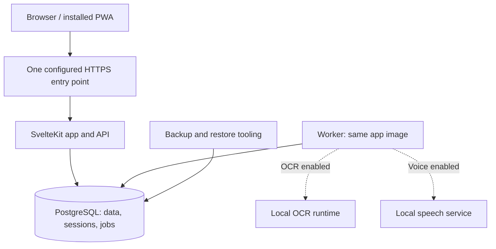

# obur — Product and technical design

> Canonical design document, maintained in the repository. Revised: 2026-10-25 (owner edits reviewed and reconciled; UI direction recorded).
> `CLAUDE.md` describes how to work; this document defines the product, data rules, architecture and release gates. Planning conversations inform changes here; they are not a second source of truth.

## Direction and decision status

**obur** (Turkish: gluttonous, someone who eats a lot) is a self-hosted calorie, weight and water tracker intended to replace LoseIt. It is a mobile-first, installable web app with an English interface and English, Turkish and mixed-language input. Food names retain the exact spelling entered. Licence: MIT.

A typical installation serves a small circle of family and friends, up to about 20 people, without a hard account limit. Accounts are always invite-only. The owner chooses product behaviour; the implementation agent makes routine technical decisions and explains consequential trade-offs plainly. LoseIt is an import source and inspiration, not a specification to copy.

Decisions have three statuses:

- **Committed:** product direction, privacy boundaries, data integrity rules and the core stack below. Change them explicitly in this file when agreed.
- **Provisional:** choices that need real data, hardware measurements or user experience evidence. State the assumption and the test that will settle it. A target is not a measured result.
- **Deferred:** useful features that are outside the first daily-use release. Do not build their infrastructure in advance unless a current feature needs it.

The risks to investigate early are import fidelity, quantity and nutrient semantics, phone usability, speech/OCR quality and latency, account recovery, offline queues, and recovery from server failure. None is proven by selecting a library.

## Scope and first usable release

The first release must make an ordinary day easy: find or create a food, choose a supported amount, save it to the intended day and meal, correct it, and understand the totals. Weight and water are quick manual entries. Logging must remain fully useful when speech and OCR are disabled.

**First daily-use pilot includes:** one deployment route, passkeys and invitations, user isolation, a small private/shared catalog, search and recent foods, calories-only quick add, diary edit/delete/undo and a Move to menu, weight and water, onboarding with BMI and an estimated base burn, a versioned daily budget (base burn plus manually entered activity calories, minus the goal's deficit), basic daily totals and weight history, a usable mobile interface, portable export/import for the implemented data, account deletion, and rehearsed encrypted backups. Historical LoseIt migration is a separate gate before the owner replaces LoseIt.

**Early follow-up:** a verified LoseIt importer, a curated generic-food import, saved meals, and a narrow typed/voice flow for actual favourite foods. Voice is a priority to evaluate early, not something postponed until all decorative features exist.

**Later:** recipes, production label OCR and barcode capture, advanced charts, a timeline, achievements (including one for every kilo lost), reminders, drag-and-drop and bulk diary actions, full offline editing, additional deployment profiles, an Unraid template, and catalog exchange between installations. These remain planned capabilities; they are not prerequisites for trying the core diary.

**Not in v1:** native apps, Apple Health/Health Connect integration, meal planning, grocery lists, social features, shared diaries or coaching. Native apps are unlikely and must not drive current architecture. A future Health integration would require a separate feasibility and product decision.

**Never planned:** open registration, billing or multi-organisation tenancy. Do not build for them or add special machinery to prohibit them.

## Architecture and stack

One modular TypeScript application and one PostgreSQL database. Start optional services only when the corresponding feature is enabled.

**Distribution (owner's decision, 2026-11-07, brought forward from Phase 5).** obur is meant to be installed by others on any machine with Docker (a VPS, Unraid, TrueNAS and the like), not only on the owner's server. It ships as three published images: **`obur`**, one container with the web app, the background worker, PostgreSQL and its backups (one data folder, backups optionally on another disk; a backup before every schema upgrade); and two optional add-ons, **`obur-speech`** (speech to text for Speak) and **`obur-labels`** (label reading for Scan), kept separate because they are heavy, optional and run with no internet access. Inside `obur` the processes still run as separate users and the runtime database roles keep their restrictions; only the packaging changed. Images are built on GitHub Actions when a version is tagged, not on every push. Install guides cover a plain Docker host or VPS, Unraid and TrueNAS, with Cloudflare Tunnel, Tailscale and Caddy for HTTPS. A future PostgreSQL major upgrade has to be handled by the `obur` container itself.

**Remote models (owner's decision, 2026-11-07; before 1.0.0).** Each person may use their own OpenAI or OpenRouter API key for Speak and Scan, after explicitly allowing it; the local add-ons stay the default. The design is in "Remote models for Speak and Scan" below.

| Component | Choice | Status |
| --- | --- | --- |
| Web and API | SvelteKit, Svelte 5, Node, strict TypeScript | Committed |
| UI and validation | Tailwind CSS, Valibot, one English message catalog using Paraglide | Committed |
| Database and jobs | PostgreSQL, Drizzle ORM, pg-boss; no Redis | Committed |
| Authentication | WebAuthn through SimpleWebAuthn server/browser packages | Committed |
| Charts | LayerChart when richer charts are introduced | Planned |
| Label OCR | PaddleOCR PP-OCRv6 small (detector and recogniser) through ONNX Runtime on images of about 1280 px, followed by a rule-based table parser | Model chosen from Phase 0 measurements (`docs/feasibility.md`); parser and end-to-end evaluation still needed |
| Speech | faster-whisper `small` (int8) in its own Python container | Chosen from Phase 0 measurements (`docs/feasibility.md`); confirm on held-out recordings before release |
| Language-model fallback | A small local LLM through Ollama, off by default | Deferred until failures justify it |
| Backups | pgBackRest: encrypted local repository required; off-site repository optional per installation (Cloudflare R2 for the owner's pilot) | Committed before production use |
| Entry point | Cloudflare Tunnel for the owner's pilot; Tailscale Serve and Caddy profiles later | Pilot route decided; hostname and RP ID live only in `.env` |

The worker claims durable jobs from Postgres. Upload and job payloads have bounded sizes and lifetimes. Jobs carry authenticated ownership, use the same isolation rules as requests, and are safe to retry. OCR and speech have separate bounded queues/concurrency so a long scan cannot indefinitely block a short voice clip or ordinary database work.

### Module boundaries

Modules live under `src/lib/server/modules/`. Add them when their functionality arrives; do not scaffold empty layers for every future feature.

| Module | Responsibility |
| --- | --- |
| `auth` | Passkeys, invites, sessions, recovery |
| `catalog` | Foods, servings, recipes, aliases, curated food import |
| `diary` | Entries, meals, saved meals, moves, trash and queued-create ingestion |
| `body` | Weight, measurements, water and recorded activity |
| `goals` | Versioned targets and, later, explicitly specified target calculations |
| `label-parser`, `nl-parser` | Pure text/geometry-to-proposal functions with explicit inputs |
| `ocr` | OCR runtime adapter and scan jobs |
| `imports-exports` | Import staging, identity reconciliation and portable data archives |
| `progress` | Achievements (kept in step with the records; shared/achievements.ts holds the rules); chart and Journal queries still compose other modules from `src/lib/server` |
| `admin` | User administration and backup/restore status |

Each module exposes a small public API and owns its writes and tests. Enforce import boundaries with linting. Cross-module operations share an explicit transaction context; imports must not become partly committed because each module opens its own transaction. Reporting queries may use documented read interfaces/views that retain RLS rather than requiring a chain of per-row calls. Migrations use one ordered application-level sequence, with ownership documented by module.

Parsers do not perform database or framework I/O. Inject clock/date context, user units and candidate data as needed; an application service resolves food matches and validates permissions. Routes remain thin. JSON endpoints used by the PWA/imports live under `/api/v1`; client-generated record IDs and operation IDs serve actual retry/offline needs.

Keep sessions and jobs in Postgres, index real access paths, paginate long lists and make worker concurrency configurable. These are enough for the intended scale; replication, microservices and generic multi-tenant frameworks are unnecessary.

## Deployment, network and maintenance

The owner's pilot runs on a home server behind Cloudflare Tunnel, on a subdomain of the owner's own domain. The WebAuthn RP ID is the parent domain, so moving obur to another subdomain later keeps everyone's passkeys. The real hostname and RP ID are recorded only in the owner's `.env` and private notes, never in the repo. Implement and test this one route first; Tailscale Serve and Caddy profiles come later for other installs. Public URL, RP ID, allowed origin and feature flags come from configuration, never real hostnames in source control.

Changing an RP ID generally requires credential re-enrollment; treat hostname migration as a migration project, not a harmless `.env` edit. Local development uses `localhost`; real-phone tests use a separate HTTPS development origin and accounts, preferably `tailscale serve` on the development PC so the test build isn't public. Trust client-IP headers only from the configured proxy path, with direct application access blocked.

No telemetry, external food/product queries or outside error tracking. Nutrition photos, audio and transcripts are processed locally, unless a person chooses their own remote model for Speak or Scan ("Remote models for Speak and Scan"), which sends only that person's recordings or photos to the provider they confirmed. Explicitly configured infrastructure is a separate boundary: an entry-point provider, encrypted off-site storage, and later opt-in Web Push or notification delivery can contact outside services. Document the provider and data sent; keep reminder payloads generic. The one request obur makes by its own choice is the **check for new versions** (owner, 2026-11-13): off until an admin turns it on in Members → Updates, it then fetches GitHub's public list of obur's version tags, with no account, cookie or installation detail in the request (GitHub sees the server's address and a generic client name), at most once a day and only when an admin opens Members or More. A newer version is shown to admins only: a notice in Members with a link to the updating guide, and "Update available" on More's Household row. Someone on a full release is told about full releases only; someone on a test release also about newer test releases. A failed request changes nothing and is retried after an hour. obur never downloads or installs anything itself (`modules/updates`, `shared/version.ts`; the answer is kept in `household_settings`). Do not describe a provider-mediated deployment as making no third-party connections. Model/catalog downloads happen during setup or deliberate updates, with version and licence recorded.

OCR and voice are independently disabled at the UI/API/job boundaries; disabling voice also stops the speech container. Core logic does not scatter feature-flag checks. Labels are read by the local OCR add-on, or by a vision model only when a person chooses their own remote model; either way the parser, checks and confirmation are the same. Browser OCR and Whisper fine-tuning are deferred, not promised improvements.

Publish versioned app images from CI on tagged releases. Pin supported Postgres and model/runtime versions. Dependency updates are reviewed with tests and release notes; green CI is necessary but not automatic permission to merge. Do not auto-update production containers. Structured JSON logs omit credentials, raw health records and unnecessary transcripts; configure rotation and retention. Healthchecks distinguish process health from readiness. Upgrade and rollback ordering are defined in the data-safety section.

## Mobile interface and design process

obur should feel joyful to use without ever being slower to use. Practical first, fun second, and the fun lives in small moments, not in the layout.

- **Cohesion:** one design system (colours, type, spacing, components) used everywhere; no one-off screens.
- **Joy in moments:** a satisfying tick when something is logged, a proper celebration for each kilo lost, friendly copy, a confident palette. Animations are short, never block input, and respect reduced motion.
- **Calm everyday screens:** nothing decorative between the person and logging food.
- **Density where it helps:** numbers and lists compact and scannable; anything tappable stays large.
- **Mobile first, desktop as good:** desktop gets its own layouts (side nav, two columns), not a stretched phone.
- **Modern conventions** over novelty.

**Process:** a few distinct visual directions are built as clickable demos for the core Today and Log flows, phone and desktop, light and dark, filled with real long Turkish food names. The owner picks one and it's refined together, for example in the Claude app. The chosen direction is recorded in `docs/ui.md` and reusable tokens in the repo, so it doesn't depend on any external conversation. **Chosen direction: Pazar** (2026-10-25); `docs/ui.md` is authoritative on visual and interaction matters, with the reference demo in `docs/ui/`. After that, add tokens/components as screens require them, documenting additions without seeking approval for every spacing decision.

**Design review (2026-11-06):** the owner reviewed every screen; the outcome is in `docs/ui.md`, "Design review, November 2026", which wins over the bullets here on look and interaction. The main changes: Recent is always visible on Log; Type it replaces Quick add; Pazar stays the default among eight complete themes; setting up a budget stays optional and is never nagged about.

- Phone-first layouts, then useful wider layouts; navigation is Today, Log, Journal, Progress and More.
- Light and dark themes, WCAG AA contrast, accessible names, keyboard operation, 200% text resizing, reduced motion and safe-area insets. Web touch targets are at least 44 by 44 CSS pixels.
- Prioritize search and fast repeat logging. Recent and favourite foods appear as suggestions when the search field is focused and empty; there are no standing Recent/Favourites lists (owner's UI decision, `docs/ui.md`). Speak and Scan are tiles in the core Log screen. Until each feature is implemented they appear disabled and labelled "Coming soon" (owner decision, 2026-10-25); once implemented they are hidden when switched off in configuration. Nothing decorative blocks entering or correcting a meal.
- Every drag action eventually has a menu equivalent. Menus ship before drag-and-drop.
- Stable deep links open supported actions pre-filled but never write data by merely opening a URL. A button or explicit confirmation performs the write.
- PWA manifest shortcuts and optional Apple Shortcuts are later conveniences. Verify actual routing, authentication and installed-app behaviour on the supported phones; do not assume Safari and the installed app share sessions or that links open the desired surface.
- Camera, barcode scanning, microphone permission and recording formats require real-device checks. Browser viewport emulation does not establish phone hardware compatibility.
- Reminders are per person, opt-in, and include quiet hours. **Built 2026-10-31 (owner's choices):** breakfast, lunch and dinner (each only if that meal has nothing logged), a weigh-in (only if none that day) and marking the day complete (only if it isn't), each at a chosen local time, sent within an hour of it, once a day, never in quiet hours (default 22:00 to 08:00). Delivery is Web Push from the worker every five minutes (`send-reminders`, pg-boss), only when `VAPID_PUBLIC_KEY`, `VAPID_PRIVATE_KEY` and `VAPID_SUBJECT` are set (`npm run push:keys`); otherwise the feature is hidden. **Provider and data sent:** each browser's push service (Apple's for iPhones, Google's for Chrome, Mozilla's for Firefox) receives an encrypted payload (RFC 8291) it cannot read, plus the device endpoint, timing and size. The payload is one plain line as the notification's title ("Lunch isn't logged yet", "You haven't weighed in today", "Mark today complete?"), with no body, never values; iOS adds "from obur" itself (owner's choice, 2026-10-31). On iPhone it works only in the app added to the Home Screen. Settings (`reminder_settings`) are exported with the account and imported only into an account without them; push subscriptions are credentials and never exported; sign-out removes this device's subscription for that person. The worker reads who is due through `app_reminder_candidates()` (settings only, active accounts with a device) and checks the diary under each person's identity before recording the send (`reminder_sends`, one per reminder and day) and delivering. A device is removed when its push service says it is gone, or after five failed deliveries in a row.

## Interface language (planned, owner 2026-11-14)

Status: review done 2026-11-14 (go); glossary approved (`docs/tr-glossary.md`). Built so far: the language setting, hidden (`shared/languages.ts`: `ENABLED_LANGUAGES` lists only English until the Turkish text is reviewed). The profile keeps `language` (export and import too); the cookie `obur_lang` is written on every page so server and browser agree; paraglide's strategy `custom-obur` picks cookie, then the phone's Accept-Language, then English, always among enabled languages; an account whose language differs from the page sets the cookie and the page reloads once after clearing prepared and cached pages. A stored language that isn't enabled shows English. Built since (2026-11-14): the full Turkish catalog (`messages/tr.json`, 1444 messages; `shared/messages.test.ts` fails on a missing or extra key, different placeholders or a suffix on a placeholder); dates per language in `shared/format.ts`; the decimal mark per language (`shared/numbers.ts`: `formatDecimal`, `fixedDecimal`, `percentText`), so English now shows 72.5; reminders in each person's language (the worker reads `profiles.language`; `server/reminder-text.ts`); passkey default names and the manifest description from the catalog. The profile's old `decimal_mark` column is no longer read for display. Built-in foods (2026-11-14): Turkish names and portions in `shared/curated-names.ts` (a test fails if a built-in food or portion lacks one), shown only for foods marked built-in: search results and food details carry `curated`, and so do diary, saved meal and recipe copies (`FoodSnapshot.curated`, set by `snapshotOf`; migration 0052 marks earlier copies by their food link, display only). Stored names stay English, now with decimal points. Household measures named per language (`shared/measure-names.ts`); the US cup unit says its size. Preview (2026-11-14): `OBUR_PREVIEW_LANGUAGES=tr` on a server offers Turkish there before its release (`config.languages`; the worker reads it too), so the owner can read the real app in Turkish; with more than one language, More → Settings shows Language. The API refuses a language the server doesn't offer. The e2e server previews Turkish (`turkish.e2e.ts`: Today pictures, no sideways scrolling on 20 screens, built-in names and portions); the features-off server checks it stays hidden. Releasing Turkish = adding it to `ENABLED_LANGUAGES`.

- **Choice:** English or Türkçe, per person, kept with the account preferences (backup and export) and mirrored in a cookie so pages render in the right language at once. Before sign-in (sign-in, join, setup, recovery) the last language used on that device, else the phone's language. Switching reloads and clears the service worker's prepared and cached pages, which hold rendered text. The switch stays hidden until the Turkish catalog is complete and reviewed.
- **Text:** a second catalog `messages/tr.json`, tone "sen". Sentences with an inserted name are phrased so no suffix hangs on the placeholder. A test fails when `tr.json` misses or adds a key or its placeholders differ. Every later string change carries its Turkish in the same commit. Typed food names, brands and notes are never translated. A glossary of about 40 key terms is approved before the full translation.
- **Numbers and dates:** the decimal mark follows the language: a period in English, a comma in Turkish; input accepts both in either. Dates use per-language tables in `shared/format.ts` (Turkish order "20 Ekim Salı"). `lang` is set on the page.
- **Reminders:** the worker sends each person's reminder in their language.
- **Built-in USDA foods:** kept. In Turkish they show Turkish names that say what the values are (feta stays "Feta peyniri", not "Beyaz peynir"), and portions are translated from their parts; history follows the language for these fixed names (display only, values untouched). Weights stay as USDA measured them; the cup stays USDA's, labelled with its size ("US cup (237 ml)", "ABD bardağı (237 ml)"). No cup setting: converting between cup sizes would be an app-made guess about packing; a person who measures with their own glass adds a weighed portion to that food (rejected: a per-person cup setting, replacing cups with su bardağı, dropping the USDA list).
- **Household measures:** the five seeded glasses and spoons get a name per language (Water glass / su bardağı, Tea glass / çay bardağı, Tablespoon / yemek kaşığı, Dessert spoon / tatlı kaşığı, Teaspoon / çay kaşığı), same ml.
- **Diary:** unchanged; entries keep their snapshots.
- **Members** (owner, 2026-11-14): the people on one server, and the admin page under More, were called Household until 2026-11-14 (friends aren't a household). Sentences name members ("Shared by another member", "An admin can …"); Turkish "Kullanıcılar". The page moved to `/members` (`/household` redirects); admin APIs are under `/api/v1/admin/`; the settings table keeps its name `household_settings`. Household measures (glasses, spoons) keep their name.
- **Unchanged in English:** README, install guides, docs, the export format and log lines. The owner's "English examples only" rule keeps applying everywhere except the Turkish interface itself.
- **Review page stops:** tab bar and main buttons; Today and Log filled in; sentences with inserted names; dates (day titles, Journal, chart axes); built-in foods and portions; numbers in both languages; a Help answer for tone; the glossary. Each phone and desktop, light and dark, Turkish beside English.
- **Order after the review:** glossary, language setting (hidden), full translation with dates, numbers and reminders, USDA names and portions, layout fixes and Turkish screenshot tests, owner's full text review, release.

## Diary and logging rules

An entry belongs to the diary date and meal selected by the person, not the upload time. Store an explicit local diary date, IANA time zone, optional eaten/measured time, creation time and server modification revision. Weight, water and activity also retain the intended local day so backdating, travel and delayed uploads behave consistently.

Default to the day being viewed. For a Today/log-now shortcut before a configurable cutoff (initially 04:00), offer the previous diary day without silently changing a deliberately selected day. Resolve spoken relative dates using the captured local context and show the resolved date in confirmation; a retry tomorrow must not reinterpret yesterday's phrase.

Each diary entry stores a self-contained snapshot: food name/brand, amount and basis, serving conversion and its provenance, nutrient values/qualifiers, source, and any explicitly accepted estimate. Later food edits, merges and deletion cannot rewrite it. Editing an old amount uses that entry's snapshot; applying newer food information is a separate explicit action.

Manual food selection and save is already a confirmation; do not add a second modal to routine logging. Parsed voice/text/scan proposals require an editable confirmation showing food, quantity, unit, day, meal and warnings. Nothing is saved in the background from interpretation alone.

Calories-only entries accept an explicitly provided number and optional description, with other nutrients unknown. The rule against invented calories applies to inferred food matches, not to an explicit statement such as "300 kcal snack". Activity, weight and water likewise use the confirmed numeric input.

Ship edit, delete/undo and Move to first. Add copy meal/day, multi-select, saved meals and drag-and-drop incrementally. Copying uses stored snapshots unless the user chooses to refresh the foods. A saved meal stores its own snapshot of each item, like diary entries; refreshing it to current food values is an explicit action. Logging it creates ordinary editable entries. Implemented in Phase 2 (2026-10-30): saved from live entries of a meal; private to the owner (no admin access, not shared with other members); logging chosen items is atomic and idempotent by client entry IDs; refreshing re-snapshots each food item the person can still see, keeping amount and unit and matching a serving by ID, then by name (editing a food recreates its servings); items whose food is gone, hidden or no longer convertible keep their snapshot and are counted. Deleting a saved meal never touches entries logged from it. Managing a saved meal is separate from logging it (owner decision 2026-10-30): an editor page renames it, changes item amounts and units, removes items, adds foods and creates a meal from scratch; one Save replaces the name and items in one transaction with a revision check (a new meal is idempotent by its client ID). Kept items re-scale their own snapshot, as a diary correction does, and new foods are snapshotted on the server; only the explicit refresh reads the catalog for kept items. Quick-add items can be kept or removed, not changed. Saved meals are online only. **Bulk actions (Phase 4, built 2026-10-31).** `POST /api/v1/diary/entries/bulk` applies one action to up to 100 entries in one transaction, all or none: `place` sets each entry's day and meal if it is unchanged since it was read (moves, and a move's undo), `copy` makes new entries from the originals' own snapshots under client-chosen IDs (a retry never copies twice; copying again with new IDs makes legitimate repeats), `delete` and `restore` use the 30-day trash. Every entry must be the person's and live (restore excepted); otherwise nothing changes. Not queued offline (the offline scope covers new records only).

## Data model and nutrient contract

The following is a logical model, not a demand to create all tables in the pilot. Final names and indexes follow actual queries. Shared reference data and authentication bootstrap tables need deliberate access policies rather than a blanket ownership rule.

| Entity | Key data and invariants |
| --- | --- |
| Users and preferences | Identity, role, units, time zone; only collect profile measurements needed by enabled features |
| Credentials, sessions, invites, recovery tokens | Explicit owner/issuer, token hashes where applicable, expiry/revocation; no passwords |
| Foods | Stable ID, owner or curated-system ownership, private/server visibility, name/brand, nutrient basis, source nutrient definitions, reported values, serving conversions, provenance, optional barcode, archived/deleted status, row version |
| Food revisions | Not built: recipes pin ingredient snapshots instead (Phase 3 decision) |
| Servings and household measures | Portion name, quantity and supported g/ml/count conversion; no implied mass for an unweighed portion |
| Recipes and ingredients | Owner-only ingredient snapshots and amounts, serving count, optional cooked weight; the recipe's food holds the per-serving totals |
| Favourites and aliases | Per-user links; reviewed shared bilingual aliases are distinct from personal corrections |
| Diary entries | Owner, intended day/meal, amount, independent snapshot, optional food reference, revision and deletion state |
| Weight, water, measurements, activity | Owner, intended local date/time, metric amount, source identity, revision and deletion state |
| Targets and daily budgets | Effective dates, calculation version/inputs or manual target, activity-credit policy, frozen historical values |
| Saved meals | Owner, named list of item snapshots and amounts |
| Import batches and source records | Owner, format/version, file hash, stable source identity or row fingerprint, reconciliation decisions and outcome |
| Queued operations | Owner, unique operation/record ID, payload fingerprint and durable result for safe retries |
| Scans and parser cases | Owner, OCR/transcript and structured proposal/correction, retention/consent; no persistent production media |
| Day completion | Owner, intended local date and when it was marked complete; LoseIt's daily `Complete` markers import here |
| Later features | Achievements, timeline, notification settings, sync tombstones/cursors as required |

### Quantities and source values

Support three nutrient bases: **per 100 g**, **per 100 ml**, and **per named serving/count** when mass or volume is unknown. Preserve the original basis and serving quantity. A serving-only food cannot be logged in grams until a justified conversion is supplied.

Never assume 1 g/ml. A volume-based food can use volume portions directly; a mass-based food needs a food-specific mass per portion or known density. Missing conversions trigger a question or a supported-unit choice. Unit choices list only units the food converts from; a serving whose label merely restates its size ("100 g" for 100 g, as in LoseIt-imported rows) is left out in favour of g or ml, defaulting to that size, except when editing an entry logged in it. Any user-entered estimate is explicit and retains its provenance in the snapshot.

Household measures are named portions, not universal physical units. Seed commonly used volume presets such as su bardağı 200 ml and yemek kaşığı 15 ml, clearly editable. Seeded in Phase 1: su bardağı 200 ml, çay bardağı 100 ml, yemek kaşığı 15 ml, tatlı kaşığı 10 ml, çay kaşığı 5 ml (volume only; an admin editor comes later). Do not assign an arbitrary universal bowl size. Distinguish US/imperial cup and fluid-ounce definitions in settings and import mappings. Store physical quantities in metric; count-based servings remain counts. Convert only at input/display boundaries with defined decimal precision and rounding.

Each nutrient preserves its source identifier/definition, unit, reported numeric value and qualifier (`as-reported`, `less-than`, `derived` or explicit estimate). Missing is null. Do not turn `<0.5 g` into 0 or 0.25; retain the bound and show it. Arithmetic propagates bounds/estimates, and totals show partial coverage when a contributing value is unknown. Zero means reported zero, not an omitted field.

### Mixed-source nutrition

The interface supports energy, fat, saturated fat, carbohydrate, sugars, fibre, protein and salt, plus source-provided extras. Not all sources supply every nutrient. Energy from the source/confirmed label is retained; macro arithmetic is diagnostic, not a replacement for it.

USDA carbohydrate-by-difference includes fibre; EU-style reported carbohydrate is a different definition. Store total-carbohydrate and carbohydrate-excluding-fibre meanings separately. Never sum them into one field without a conversion policy.

For a consistent dashboard, use carbohydrate excluding fibre. EU-style values map directly when their source definition matches. A total-minus-fibre value may be derived from compatible USDA/US fields as an **estimate**, with the original values retained; missing fibre or inconsistent/negative results leave that derived field unknown and require review. Display derived/partial status and preserve the source's reported total carbohydrate in food details and exports. Confirm the exact nutrient-ID mapping against the dataset version before import. This convention is not a claim that a difference calculation is a laboratory measurement of available carbohydrate.

Salt derived from sodium uses explicit mg-to-g conversion and a documented factor, retaining the original sodium. Calories/kilojoules retain original values and derived-display provenance. Source schema, dataset release and mapping version accompany imported data.

Reference: [USDA Foundation Foods documentation](https://fdc.nal.usda.gov/Foundation_Foods_Documentation/) and [EU nutrient definitions and energy factors](https://eur-lex.europa.eu/legal-content/EN/ALL/?uri=CELEX%3A32011R1169).

## Food catalog and recipes

The local catalog combines curated generic foods, private imported foods, confirmed scans and manual entries. There are no runtime external product lookups. USDA Foundation Foods and SR Legacy are candidate sources for generic foods; verify field coverage and dataset versions, import a useful subset first, and avoid importing US branded foods by default. **Phase 2 implementation (2026-10-30):** 102 curated foods (`catalog/curated/selection.ts`): the generic foods in the owner's LoseIt history plus everyday staples, all from SR Legacy (2018-04), because every SR record has plain energy, sugars and household portions with gram weights, while most Foundation Foods (2026-10-29) lack plain energy and portions. `npm run curated:build` reads the downloaded archives (checked by SHA-256, recorded in the script) and writes `curated/usda-foods.json`, which is committed; the app never contacts USDA. Mapping (`catalog/usda.ts`): nutrients by USDA number with the unit checked; carbohydrate by difference is `carbohydrate_total`, with carbohydrate excluding fibre derived as an estimate, salt from sodium and kJ from kcal as derived values; missing nutrients stay unknown; Foundation energy falls back to the Atwater specific factors (958), then general (957), and records which. Portions keep USDA's gram weights (source `reference`), at most eight, without the US labelling references (RACC, NLEA serving). Their names are made metric at build time (`catalog/metric-portion.ts`, owner request 2026-10-30): inches to centimetres, ounces and pounds to grams, fluid ounces to millilitres, "tbsp"/"tsp" spelled out, cups named "US cup (237 ml)" because the gram weight was measured for that cup, and portions that only restate a unit (oz, lb, fl oz, quart) dropped; the build fails if a US measure remains in a name. `obur migrate` loads the file as shared, ownerless foods (`origin = 'curated'`, unique by dataset and USDA ID), adding missing ones and bringing foods nobody has edited (version 1) in line with the file: name, aliases, values and portions. Diary entries and saved meals keep their own snapshots. Turkish aliases are reviewed, searchable but not shown, and kept in `source_meta.aliases` so edits keep them. The food page names the source. Some aliases are approximations of Turkish products (feta for beyaz peynir, cheddar for kaşar, cantaloupe for kavun); the displayed name always says what the values are.

Foods people create by hand and confirmed label scans are shared on the server by default, with a private option when adding one. Foods imported from LoseIt are private by default, because years of imported foods reveal more about a person's habits than any single product; the import preview offers sharing all or selected foods. Sharing publishes only food content, never diary links, usage times or who logged it. A curated shared catalog remains available for discovery. Shared API responses omit personal attribution/provenance that is not needed to use the food.

**No automatic copy on first use.** A user can log an accessible shared food directly; the diary snapshot preserves history. Only its creator or an admin edits it; only the creator can change who can see it (an admin cannot make someone else's food private). Edits carry the version they were based on and a stale edit is rejected rather than overwriting. Foods are archived, never deleted, through the app. Hand-made foods must state energy (kcal or kJ); imports may lack it. Someone wanting different values chooses "Make my own variant", which creates a private copy that records where it came from. Future selections use the food's current values, while saved meals keep their snapshots until explicitly refreshed. No update-notification system is required for the pilot.

Barcode and normalized name/brand suggest duplicate candidates; they do not prove identical formulation or serving basis. Never silently overwrite values or merge distinct imported foods because names match. An admin can merge duplicates; search then points to the kept food, and diary snapshots are untouched. Archive superseded products; a barcode can match several foods (for example after a formulation change), shown for the person to choose.

Search prioritizes recent/favourite foods, the user's private foods, then shared references. Implemented (Phase 1): every query word must appear in a folded brand-and-name key, in any order, or the whole query must be trigram-similar (typos); real matches come before typo matches, and within each the person's own foods come first; recent foods join the ranking with the diary. Preserve original spelling; use Unicode normalization, Turkish-aware casing for Turkish matching and transliteration-aware search so `sutas` finds `Sütaş`. English and mixed text need test cases too; do not apply Turkish casing blindly to every language. Shared EN→TR aliases start with a small reviewed useful set and grow from real searches. Learned corrections remain per-user and can be edited/deleted.

Recipes introduce food revisions: they pin ingredient versions and explicit quantities, including valid volume or serving quantities. Sum ingredient nutrients with unknown/derived flags propagated. A recipe can be logged by a declared serving count; per-100-g cooked nutrition is available only with a measured or explicitly entered cooked yield. Do not infer cooked yield from raw ingredient mass. Disallow circular recipe dependencies.

**Phase 3 implementation (2026-10-30), recipes.** A recipe is a food (`origin = 'recipe'`, basis per serving, label "serving") with a `recipes` row (servings, optional cooked weight) and `recipe_ingredients`. Instead of separate food revisions, each ingredient pins a snapshot of its food, as diary entries and saved meal items do (implementation decision: the same guarantee with one mechanism); catalog edits reach a recipe only through its explicit "Update to current food values". Values per serving are the ingredients' sum divided by the servings: a nutrient is known only when every ingredient states it, `derived` from exact values or an `estimate` when any part is an estimate or an upper bound. A cooked weight gives each serving a gram size, so the recipe can be logged in grams; without one it is logged by servings only. Recipes can't contain recipes yet (no cycles possible). The food form refuses recipes, for the owner and for admins. Only the owner sees the ingredients (RLS on both tables, owner columns cascading on account deletion); anyone else who can see a shared recipe sees a plain food with its totals, which is the "flattened public food" below. Logging, search, saved meals and diary snapshots treat a recipe as any food.

Sharing a recipe requires every exposed ingredient revision to be shareable; offer a flattened public food with totals when the author wants to keep ingredients private. Deleting/privatizing a source food must not leave broken recipe permissions: retained snapshots support existing recipes, but no new lookup may expose private source data. Account-deletion rules govern previously shared revisions.

Catalog export/import between installations is deferred. When added, export only authorized shared foods plus their necessary public dependencies; preserve versions where they exist and show duplicate candidates instead of destructive automatic merges.

## LoseIt import and migration fidelity

Inspect an actual owner-supplied export in phase 0 before finalizing schema assumptions. Record the actual files, headers, date/time conventions, units, stable identifiers, nutrient coverage and recipe/exercise gaps in a fixture/schema note. Do not promise that a third-party description or a particular subscription/export route matches today's product. Keep real health history out of the public repository; use a redacted fixture preserving edge cases.

1. Detect a supported version from headers and validate file/archive limits. For unknown layouts, explain the mismatch and stop before writing; a general column-mapping UI is deferred.
2. Stage and validate the whole import, including dates, quantities, missing masses and source nutrient definitions. A serving-only item stays serving-only. Preserve source values rather than reconstructing them from today's catalog.
3. Preview new, unchanged, changed, ambiguous and rejected records, date range and daily totals. Never silently discard errors. Hash the file per user/source to recognize exact repeats.
4. Reconcile overlapping exports using source entry IDs where available. Otherwise use a documented fingerprint plus occurrence/multiplicity handling, preserving legitimate repeated identical meals. Changed or ambiguous historical rows require an explicit preview decision; a fingerprint is not proof of identity.
5. Commit approved database changes and import identities together in one transaction. Revalidate relevant versions/permissions at commit so an old preview cannot apply blindly. A failure leaves no partial history or catalog mutations.
6. Imported foods are private by default (see Food catalog); match source IDs and content, not only name/brand/serving. Entries retain the exported nutrient snapshot. Exercise values retain their source meaning and do not automatically increase a budget until that meaning is understood.
7. Reconcile counts and daily calorie/nutrient totals to the source, with explicit tolerances only for documented rounding. Preserve unavailable data as unknown. Retain the original export independently until migration is accepted.

**Phase 2 implementation (2026-10-30).** LoseIt rows have no IDs: a row's identity is its exact content plus its occurrence among identical rows, so legitimate repeats stay separate and an overlapping export adds only rows not seen before. Rows imported earlier but missing from a newer export (deleted or edited in LoseIt) are counted in the preview and moved to the trash only if the person ticks that option. Diary rows keep LoseIt's totals in their own snapshot and link to a custom food only when exactly one has that name. LoseIt database foods become private foods from their latest diary row. Carbohydrate is stored as `carbohydrate_unspecified`. Budgets become manual target versions from each date they changed, only before the first target set in obur. Activity is recorded with `counts_toward_budget = false`. Weight unit and time zone come from the preview. **Archive foods from LoseIt (2026-11-08):** Your data offers one step that archives every food the person imported from LoseIt (`origin = 'loseit'`, their own only) and one that brings them all back; archived foods leave search and Speak, diary entries keep their snapshots, and archiving any single food stays available for every food the person owns. Serving definitions and recipes are not imported: the servings file adds no usable portions (custom foods' rows are grams or millilitres; database foods have no stated base), and recipes have no ingredients.

The replacement gate includes exact-repeat and overlapping-export tests, repeated identical meals, changed rows, unknown serving weights, decimal commas, date boundaries and an export/import round trip. Known export omissions are reported to the owner; do not fabricate recipe ingredients or promise full fidelity for fields the export lacks.

## Offline scope and synchronization

The pilot supports cached viewing and queued **new** diary, weight and water entries. Offline creation uses cached accessible foods and known conversions, or explicit manual/calories-only input. OCR, speech processing, catalog changes, imports, and editing/deleting already-synced records require a connection initially. Users can edit or discard a local unsent draft. Pending records are visibly pending, not reported as saved to the server.

- Every create carries a client-generated record ID, operation ID, owner binding, immutable proposed payload and captured date/time-zone context. The server derives identity from the session, never trusts a submitted `user_id`.
- In one transaction, validate access/units, create the record and store the operation outcome. Replaying the same operation returns the same result; reusing its ID with different content is a conflict. A submitted operation is not rewritten while its outcome is uncertain.
- Keep accepted IDs/deletion markers sufficient to prevent a late retry from recreating a deleted row. Payload details can expire earlier than the minimal deduplication record. Deleted accounts cannot submit old queues after re-enrollment as a new identity.
- If a food or permission changed while offline, keep the local draft and request review. Do not silently substitute current food values or apply a new conversion.
- Retry on foreground/reconnection; do not depend on background sync running on every phone. Expired sessions pause sending and require login to the same account. Storage eviction or clearing browser data can lose unsent drafts; the UI distinguishes local-only data from server-backed history.
- Partition IndexedDB/caches by account. Never send one account's queue as another user. Clear sensitive caches on sign-out; if unsent drafts exist, explicitly offer to reconnect/sync before signing out or discard them. Disable/revoke access on the server even if an offline device still has a local copy.

**Phase 1 implementation (2026-10-26).** One IndexedDB queue per account (`obur-queue-<user id>`), sent strictly in creation order; a new entry waits behind older ones. Unreachable is inferred from a failed request, a 10-second timeout or a 5xx answer, never from `navigator.onLine`. Sending happens on load, on the `online` event, on return to the foreground and every 30 seconds while something waits. A 401 pauses sending and asks the same person to sign in again; any other refusal keeps the draft for review. Unsent drafts can be discarded; editing a draft is done by discarding it and entering it again (provisional). The service worker serves the app shell cache-first and signed-in pages, their data and a few read-only API responses (food detail, recent foods, measures, a diary day) network-first with the saved copy as fallback. When a page shows the saved copy, it says so and refreshes at the next send attempt. Owner's iPhone test (2026-10-29) led to: a 3-second limit when someone taps Save (background sends keep 10 seconds), and after a failed request new entries go straight to the queue for a minute, because iOS can leave offline requests hanging; sheets close before their confirmation shows; the app saves a copy of every main tab and its data in the background once per start, so tabs never opened online still open offline; hashed code files are matched ignoring `Vary` (a module import sends an Origin header the install-time copy lacked, so page code was never found offline); the previous version's code stays cached, so a page opened before an update keeps working offline; a confirmation survives a full page reload. The root cause on the iPhone was Cloudflare caching the service worker file (`.js` is cached by default): the stale worker listed files that later builds no longer had, its all-or-nothing install failed, and the app had no offline support. The production server (`server.js`) now sends `Cache-Control: no-store` for the service worker and the manifest, and the install caches file by file. The same server is used by the browser tests. The service worker has the same one-minute memory as the queue: after a failed or timed-out request (3 seconds), pages and their data come from the saved copy at once, while the network is retried in the background. A saved page is refreshed only when something arrived or a quick check (bypassing saved copies) reaches the server, because a failed refresh makes SvelteKit reload the whole page. A page that reads its own query (Log) is served from its plain saved copy; any other page never saved shows a "Not available offline" page instead of another page. Offline food search says it needs a connection and offers quick add. Sign-in pages and all writes always use the network. Saved pages are cleared on sign-out and when a different person signs in on the device. The worker purges trash older than 30 days nightly through a reviewed SECURITY DEFINER function, leaving a minimal marker (ID, owner, kind, time) in `purged_records`; a create that reuses a purged ID gets `410 gone`, and the offline queue then drops that item.

**Page changes and the saved copies (2026-11-13).** Measured on a connection with 150 ms added to every request, each page change took about 205 ms, all of it one trip to the server: the two layouts loaded their data again on every change (settings, today's date, waiting celebrations, what reads recordings and photos), so even pages with no data of their own (Log, Help, Appearance, Units, Your data, Passkeys, the new-food form) waited for the server. Now a page change loads only the page; the layouts' data is named `obur:account` (`shared/account-data.ts`) and the app layout asks for it again in the background after a page change once it is 30 seconds old and when the app returns to the foreground; every save still refreshes everything. Page loads work out today's date themselves rather than reading the layout's, so that refresh never reloads the page being looked at (the first version, in beta.10, reloaded Today a moment after every arrival and replayed its title's animation: the owner saw the date flash). Log keeps recent foods and saved meals per account between visits and only updates them. **Pages prepared ahead (owner's choice, 2026-11-13, after rejecting "show the saved copy, then update", which can change a page in front of the person):** while a page is open, the service worker fetches the data of the pages likely to be opened next (the tabs, the open page's own links up to ten, anything marked `data-prepare`, and the API lists Log shows), again after every page change, every save, a return to the foreground and every 45 seconds in view (`client/prepare.ts`, `shared/prepare.ts`). A tap is answered from that copy when it is under a minute old and asks for exactly the page's own data; anything else goes to the server as before, and nothing ever changes on screen after it appears. Writes go through the service worker, which drops every prepared copy when a write starts and again when it ends, and keeps nothing fetched while one was under way, so a prepared page never predates a change made on this device (`prepared.e2e.ts` fails without this). Other devices' changes can be up to a minute old on a prepared page. A finger touching a food or saved-meal row (`data-prepare-touch`) prepares its details before the sheet asks; a request for something being prepared waits for that answer. A preparation that fails or hangs sets the same one-minute "unreachable" hold as any request, so at most one page change waits on a hanging connection. Household, Your data and Passkeys get their lists with the page instead of fetching them after it opens (`server/as-json.ts` keeps the API's shape). Measured with 150 ms added per request and a 4x slower processor: every tab and More section opens in 60–75 ms (was about 205 ms). Server time with a 400-day history (about 3,300 records): every page's data under 10 ms on the development machine, so on a phone the cost is the trip, not the server. Every answer carries `Server-Timing`, and requests over 300 ms are logged (`obur: slow: METHOD /path N ms`, never the query). Pages without data of their own open in about 65 ms on the same connection; the others still take one trip. Because a page change now brings only part of a page's data, the service worker builds each saved copy up (`shared/page-data-copy.ts`: an answer replaces the parts it carries and keeps the rest; a request gets only the parts it asked for), answers the page before writing the copy (it used to write first), looks for code files in the current version's cache before the others, and the app layout reads every page's code in ahead of the first visit. The tab bar marks the tapped tab at once. Not measured on an iPhone: the numbers are from phone-size Chromium with a four times slower processor.

Online edits use server revisions and expected-version checks. A stale edit gets an explicit conflict response; client clocks do not determine the winner.

**Day notes are the one exception to "no last-write-wins" (owner's explicit choice, 2026-11-01).** A day note is one free-text Markdown note per person per day, private to that person like the rest of the diary. It saves itself. An offline edit is kept on the device and sent later; the last version typed wins, by the time it was typed. A clock set ahead counts as the server's now, so a wrong clock can't block later edits. An emptied note stays as an empty row, so an older edit sent late can't bring it back. This is accepted because a note holds no nutrition or budget data and only one person writes it. Notes are included in the export like all user-entered data (`data/day-notes.json`; emptied notes are left out, and older archives without the file still import), and server backups hold them as part of the database. An import keeps whichever version of a day's note was typed last. Nothing else may use this rule.

**Full offline editing is deferred.** Its prerequisite design must cover revisions, conflict choices, deletion tombstones beyond the 30-day undo window, explicit restore versus stale edit, sync cursors, maximum supported offline age, and full resynchronization for older clients. "Latest edit wins" is not the policy. Implement and test those cases before expanding the offline scope.

## Targets, profile and activity

**Onboarding** asks for height, weight, birth date and sex (the formulas need them), optionally body-fat % and waist. It shows BMI (kg/m²) with WHO adult categories, waist-to-height ratio when waist is given, and a note that BMI can't tell muscle from fat. None of it is presented as a diagnosis, and onboarding ends with a short note that targets are estimates, not medical advice. A person can also skip all of this and set a target by hand.

**Profile** shows the details as rows (height, birth date with age, sex, latest weight with its day, and a calculated budget's goal weight) and edits them in place (owner request 2026-10-30). A new weight is saved as today's weigh-in. Saving the other details and a calculated budget's recalculation from today are one transaction, so past days keep their budgets; nothing is recorded when the numbers don't change. If the new details no longer allow a calculation (a birth date that makes the person a minor, for example), the details are saved, the budget in force stays, and the person is told to set their own number. A hand-set budget is left alone.

**Base burn** is what the body uses on a day with no physical activity: BMR (Mifflin–St Jeor by default, Katch–McArdle when body-fat % is known) times a sedentary factor of about 1.2, which covers ordinary daily living. A person can replace it with a fixed number they choose.

**Daily budget = base burn + calories burned through activity that day − the goal's deficit.** Example: base 2,000 kcal plus 1,000 kcal burned, with no deficit, gives 3,000 kcal.

- A hand-set target is treated as the budget for an inactive day, so counted activity is added to it as well (implementation decision, Phase 1).
- Activity is entered by hand as calories burned, with an optional note. The interface states its meaning plainly: extra calories above a normal inactive day. Two kinds (owner request 2026-10-30), labelled device-neutrally **One activity** and **Day total**: one activity adds; a day total is the active calories a watch, phone or fitness app counted for the day so far (on Apple Watch, the Move ring, not total calories, which include resting burn) and the newest one replaces that day's earlier totals, so it can be entered several times a day. Single activities add on top of a day total; the sheet asks not to add activities the device already counted. No workout types, durations or exercise library.
- Activity whose meaning isn't clear, such as LoseIt's imported exercise values, is recorded with its source and shown, but not added to the budget until its meaning is mapped and confirmed.
- Goal weight and rate, from maintain to 1 kg/week; the deficit uses about 7,700 kcal per kg, capped at 1% of body weight per week. Budgets never drop below an editable floor (initially 1,500 kcal for men, 1,200 for women). These are estimates and guardrails, not guarantees of safety or exact forecasts.
- Macros (owner decision 2026-10-30): **Balanced** is the default and follows the budget: protein 1.2 g per kg of goal weight when a lower goal is set, otherwise current weight; fat 30 % of the day's budget; carbohydrate the remainder (never negative). It needs body weight, so it applies to calculated budgets only. **My own %** sets whole-percent shares of protein, carbohydrate and fat that add up to 100 % (for low-carb and similar diets), applies to any budget including a hand-set one, and gives grams from each day's budget. The choice is a budget setting: saved from today on as a new target version, kept by recalculations, weight changes and new budgets; a database check requires the three shares to add up to 1. Switching back to Balanced restores its default fat share.
- A budget set by hand may carry a goal weight too (owner, 2026-11-08): it changes nothing in the budget and feeds only the weight chart's goal line and the weight achievements. More → Goal offers it, kept by later settings changes as a new version from that day. It is not offered (and the server refuses it) when the profile says the person is under 18, pregnant or breastfeeding.
- Targets are versioned by effective date and each day keeps its final budget and inputs. Changing weight, settings or formulas never rewrites past days; a deliberate historical correction creates an auditable new version. A calculated budget follows the latest weight, as LoseIt's does (owner decision 2026-10-30): when adding, removing or restoring a weight changes the numbers of the calculated target in force today, a new version with the same choices (requested rate, goal, floor, fixed base burn, macro settings) starts today, and the confirmation says "Budget now X kcal (was Y)". The requested rate is kept, so the 1 %-of-body-weight cap is re-applied at each weight. Manual targets, "none", and states without calculated targets are never changed; imported weights (LoseIt or archive) do not trigger it. It runs after the weight is saved and never fails the weight: a missed update is caught up by the next weight change, and repeating it with the same weight records nothing. Budget settings (owner decisions 2026-10-30) travel with each target version, so a change applies from that day on and past days keep their budgets: whether counted activity adds to the budget (default on; when off, the Budget card shows how much was burned and that it was not added), and, for calculated targets with a goal weight, what happens at the goal (default: keep the deficit; or switch to maintenance, which sets the rate to zero while the latest weight is at or below the goal and restores the requested rate above it). A recalculation keeps the settings. Implementation: target versions are append-only rows storing the computed numbers and inputs; a day's budget is the newest version effective on or before it plus that day's counted activity.
- **At the goal weight** (owner, 2026-11-13). A calculated budget carries the setting "When I reach my goal weight": **Keep deficit** (the default) or **Maintain**, which drops the deficit while the latest weight is at or below the goal and brings the requested rate back above it. obur never changes it silently, since one low reading could be a fluctuation. Instead, while the latest weigh-in is at or below the goal, the budget still has a deficit and the setting is Keep deficit, Today shows a card ("You've reached your goal weight": **Switch to maintain** / **Keep deficit**) and the goal's celebration carries a **Switch to maintain** button. Accepting saves the setting from today as a new target version; declining is remembered with the account by its goal weight (`profiles.maintain_offer_declined_kg`), so the offer returns only with a new goal. Nothing is offered for budgets set by hand, which have no deficit of obur's to drop (`shared/goals.ts`, `maintainOffer`).
- Formulas are covered by fixture tests with published worked examples.

Do not automatically apply adult target/BMI calculations to minors, pregnancy or breastfeeding by just switching the deficit off. For these states, support logging without algorithmic calorie or weight-loss targets; professionally provided targets may be entered explicitly. A dedicated supported calculation path would need separate review. For these states BMI uses no adult categories and no weight-loss suggestion is shown. [NIDDK likewise limits its planner's intended population](https://www.niddk.nih.gov/health-information/weight-management/body-weight-planner).

Units are per person: body weight, height, food mass/volume, energy and water, plus date format and first day of week. Preserve count-based portions, specify cup/fl-oz systems, and accept decimal commas and dots without ambiguous thousands-separator guesses. Collect birth date/sex/body-fat data only if an enabled feature actually needs it.

## OCR and barcode capture

The candidate pipeline is capture/crop → local OCR with positions → table parsing → diagnostic checks → editable confirmation. The name and brand are entered manually; OCR focuses on the nutrition table and serving size. Decode a barcode separately when necessary; a nutrition close-up may not contain it. Verify camera focus/crop/glare guidance on real phones rather than promising unavailable camera controls.

Barcode capture is deferred (owner decision, 2026-10-31): with no outside lookups it only finds foods members already saved, which search already finds; revisit if real use shows a need. If built: a known barcode offers existing products and a rescan option; formulations can change. An unknown barcode does not trigger an external lookup. The parser identifies row labels, per-100-g/ml or per-serving basis, columns and qualifiers; it must distinguish amount columns from %RI/%DV and avoid merging multilingual duplicates.

Checks include sugars versus carbohydrate, saturated versus total fat, compatible serving/100-unit ratios, sodium/salt conversion, and source-aware mass/energy consistency. Energy arithmetic accounts for source definitions and known contributors such as fibre/polyols/alcohol where provided; missing information is not a zero. Rounded labels can disagree. Checks produce warnings, never silently repair source values or prove the selected column is correct. Do not reject a legitimate food solely because a simplified 4/4/9 check fails.

Show the cropped photo next to the editable proposal. Keep production media only until confirmation/cancellation, with a bounded cleanup TTL for abandoned/failed jobs. Production photos never enter backups. Store only the necessary confirmed values and, with retention controls, OCR text/positions/corrections for private parser cases.

**Phase 3 implementation (2026-10-30), label scanning.** Like speech, OCR is an internal service called directly by the web app for one request (`ocr/`: Python standard-library HTTP, RapidOCR 3.9.2 on ONNX Runtime 1.31 with PaddlePaddle's PP-OCRv6 small ONNX exports at pinned Hugging Face revisions, SHA-256 checked at image build, the Phase 0 configuration B at 1280 px). The phone redraws the photo at about 1600 px as JPEG (correct orientation; the redraw drops location and other metadata); the server holds it in memory for the one request, the service decodes it in memory (JPEG, PNG or WebP, at most 4 MB and 50 megapixels), reads one photo at a time with up to three waiting (beyond that it answers busy with how many it holds; the phone waits in line, asking again every 3 seconds for up to two minutes, and a busy answer does not count toward the per-person scan limit), logs nothing about requests and has no internet (internal Compose network, read-only, capabilities dropped; ONNX Runtime's telemetry events are disabled). No photo is stored anywhere, so none reaches backups and no cleanup job is needed; this replaces the queued-job design for OCR (implementation decision). The pure `label-parser` turns the lines into a proposal: tables (rows by name in Turkish and English with one-letter OCR slips tolerated; header columns per 100 g/ml, per serving with its stated size, and %RI; numbers mapped to rows following the drift of curved packs and to columns in order or by position, so a %RI value, including `%28` misread as `9628`, is never taken) and running text (values in order up to a second basis, starting at energy so ingredient names are skipped). A recognised table is never re-read as text, and values impossible per 100 g or ml are dropped: anything unreadable stays unknown. The proposal also lists what was decided (the column used and those skipped, a basis taken from the title, running text, values dropped as impossible, milligrams converted), shown as notes on Check the label. The service also reports the photo's edge sharpness; below 0.16 the photo is called blurry (provisional, measured on artificially blurred copies of the owner's labels, `docs/feasibility.md`). The proposal fills the food form (the name and brand are typed; a per-serving column's size is used only as the basis of per-serving values and is never added as a portion, owner 2026-11-09: that header is the label's least reliable line and a wrong weight would skew every later log, so portions are the person's to add; with salt present a sodium value is left out so the form keeps EU carbohydrate), beside the photo, with the form's plausibility warnings live. The food is saved with `origin = 'label_scan'` and shared by default like any hand-made food, then Log opens its amount sheet. `OCR_URL` unset switches scanning off. Barcode capture is not built. **Edit counts (owner, 2026-10-31).** Saving a scanned food also stores how much the proposal was corrected: values proposed, changed (number or "less than"), removed and filled in, whether the basis was found and whether it or the serving size changed (`label_scan_edits`, written in the food's transaction; compared on the phone with the form's starting values, so the form's own salt/sodium choice is not an edit). Counts only, never values or photos. Rows are private to the person (no admin access); admins see household totals on the Members page through `app_label_scan_totals()`. They are diagnostics, not portable data, so they are not exported; they go with the food or the account.

## Typed and voice logging

Voice fills the same text-to-entry workflow as typed input. Start with food + amount + supported unit + day/meal for common foods, plus explicit calories-only entries. Then extend to activity, weight, water and mixed intents, using a tagged proposal schema rather than pretending every result is a food.

The pure parser recognizes English/Turkish numbers, comma decimals, units, meal words and relative dates. The matching service resolves accessible foods using recent/favourite/private/shared candidates. Ambiguous foods, dates and missing portion conversions require a choice. Food nutrients come from the selected food; the parser/optional LLM never invents them. Explicit kcal/weight/water/activity values are permitted inputs.

Record in the browser and transcribe locally. Phase 0 selected faster-whisper `small`: on the target server it came within two points of large-v3-turbo's accuracy at under half the latency, while large-v3-turbo could not meet the latency target (`docs/feasibility.md`). Restrict language detection to Turkish or English (unrestricted detection produced a wrong-language, 35-second failure), prompt with the person's frequent foods and brands, and decode once at temperature 0 to bound processing time. Re-evaluate on held-out recordings, including another speaker, before release; keep the chosen model loaded and bound clip duration, queue length and concurrency. Vocabulary prompts and fuzzy matching are experiments, not guarantees of bilingual brand recognition. Preserve the original transcript for the confirmation flow, allow correction, and present a single editable result rather than requiring a separate mandatory transcript-approval screen.

Examples include "100 g Sütaş ayran", "Öğlende bir tane muz yedim", "300 kcal snack", "iki gün önce 450 kalori yaktım", "bugün 82,4 kiloydum" and "iki bardak su içtim". Dates/units are explicit on confirmation. Learning an alias from a correction is per-user, reversible and must not change another user's matching.

**Phase 2 parser (2026-10-30):** `nl-parser` (pure) returns the day (days ago), meal and tagged proposals: food (the words to search for, amount, unit: grams, millilitres or a count with the word used: slice, can, bottle, glass, container, package, piece, or none), quick (kcal, optional description), water, weight and activity. It reads digit and word numbers in both languages, decimal commas, "yarım"/"half", "buçuk"/"and a half", percentages kept in the food name ("yüzde on" → "%10"), suffixes after apostrophes ("Lunch'ta"), relative days including "geçen salı"/"last Tuesday" (the most recent past one, never today), and meal words ("sabah" only suggests breakfast). Several items split where a separator is followed by a new quantity. Development cases are sentences written for the parser (`nl-parser/fixtures.ts`); the owner's 48 Phase 0 transcripts are scored privately with `scripts/nl-eval.ts` (47/48 complete results; the miss keeps "after the gym" in a food name). Those transcripts were seen while building it, so they are a check, not held-out evidence; held-out evaluation comes with the voice recordings.

**Phase 2 typed entry (2026-10-30):** `POST /api/v1/entry/parse` proposes and writes nothing. The day is the sentence's, else the day being viewed, never in the future; foods are searched with every word required first, then the longest run of words that all match (recent foods first; only foods the person can see); a parsed unit becomes one of the food's own units (count words matched to portions by name in both languages, a bare count to a "medium" portion or the food's own serving, grams or millilitres only when the food converts); a word after a number that the parser does not know as a unit ("2 cups", "3 scoops") names a portion when the other words find a food on their own and that food has a portion of that name, singular or plural, and otherwise stays part of the food's name; fractions are read as "1/3" (also "1/3s"), "⅓", "1 1/2", "a third", "two thirds", "three quarters" and the Turkish "üçte bir" and "3'te 1", with "of a" before a unit (2026-11-09, owner reports), otherwise the person chooses; a food's own serving whose label only restates its weight ("40 g", which the amount sheet hides behind its g option) is proposed in grams, so "two" of it is 80 g; a food named without an amount is proposed as one of its own servings when it has a per-serving basis, and asked otherwise (2026-11-08, after the owner's first day: such servings had no usable unit); "bardak su" uses the seeded su bardağı (200 ml), a bottle of water is asked. Saving goes through the ordinary create endpoints with one client ID per card, so a retry never logs twice; a partial failure keeps only the unsaved cards.

Production audio is deleted after transcription, or on failure/cancellation after a bounded TTL. Saving transcript/correction pairs as regression cases is opt-in with deletion/retention controls. Separately consented recordings made specifically for testing live outside the production app and public repo; they are necessary to test speech-model changes, while transcript fixtures test the parser alone.

## Evaluation and acceptance criteria

Phase 0 is an initial risk investigation, not a promise that two days proves a complete bilingual system. Use the same model versions, preprocessing and representative settings on development and target hardware; quantization/runtime choices can affect quality as well as speed. Record hardware, model/runtime versions, memory and concurrency alongside measurements.

**Initial evaluation data:** about ten hand-checked real label photos, growing toward thirty or more varied labels; around fifty reviewed typed sentences across English, Turkish and mixed input; a small separately consented recording set; actual anonymized import fixtures; and representative daily meals/recipes/servings. Include curved packs, poor light, multiple columns, serving-only labels, bounds, decimal commas and deliberately ambiguous input.

Separate development cases from held-out evaluation cases. Report sample counts and failure categories; do not generalize from a tiny corpus. Confirmed production corrections can extend a private parser regression set with permission, but do not become independent held-out evidence merely by being replayed.

| Area | Measure | Gate |
| --- | --- | --- |
| Core logging | Time/taps to find a recent food, save it, correct amount/date; recurring meal workflow | Provisional goal: a familiar single-food entry within 10 seconds and a correction within 3 actions on the owner's phone; validate usability, then record accepted targets |
| Imports | Counts, identities, dates, quantities and daily totals versus actual source | No unexplained missing/duplicate records or nutrient changes; documented rounding only |
| OCR | Field accuracy, exact basis/column selection, complete-label zero-edit rate, serious numeric errors and correction time | Retain 98% field accuracy as a development target, not a standalone release gate; every known severe unflagged error must be resolved before release. 2026-11-07: every known misread now carries a warning or an amber note on the saved runs (`docs/feasibility.md`, "Unflagged misreads"); development evidence, not held out (owner's choice) |
| Voice | Food/amount/unit/day/intent correctness, corrections and time to confirmed entry | Compare against manual logging; decide acceptable correction rate from representative recorded results before shipping. 2026-11-07: the owner accepted the current results (numbers right in 97 % of their clips and 93 % of a second speaker's, after tuning on them) and will judge corrections in daily use |
| Latency | Full upload/queue/process/match-to-editable-result time, p50/p95 when sample size supports it | Provisional warm targets: voice p95 at most 5 seconds after a short clip ends; OCR p95 at most 10 seconds from submitting the captured image, including upload; cold start and contention reported separately |
| Phone behaviour | Installed PWA login/recovery, camera, recording, local queue and reconnection | Pass on actual supported devices; no viewport-only claims |

The latency/usability numbers are proposed acceptance targets, not published hardware capabilities. Owner experience and initial measurements settle them before release claims. Measure on the target 2-core/4-thread i3 with 16 GB RAM and record the exact CPU/storage; do not publish minimum RAM or speed claims before a full-stack measurement. If targets fail, reduce the model, simplify the supported flow or keep the feature experimental/off. Manual logging work can continue independently.

## Progress, graphs and optional encouragement

Start with daily totals and a basic weight-history view. A day counts as under budget, and is shown green in the calendar, only after the person marks it complete; a logged but incomplete day is shown neutrally, so forgetting to log is never rewarded. Missing days are unlogged, not zero intake; missing weigh-ins remain missing. A "same value" shortcut still records a genuinely measured reading and must not fabricate an observation. Distinguish an observed zero from no activity/water record where relevant.

Later charts can show raw weight and a documented smoothed trend, calorie/budget comparisons, partial nutrient totals and water targets across common ranges. Specify how smoothing treats gaps; forecasts are estimates and require adequate data. Timeline and richer charts use the same historical snapshots as the diary. The timeline is a month of highlights under the calendar in its own **Journal** tab (owner, 2026-10-31; docs/ui.md): one summary per week and only the moments that mattered, never every day.

**History (Phase 4, owner decisions 2026-10-31).** Ranges: 1 week, 1 month, 3 months, 1 year and all. Weight has two views (owner, 2026-10-31): **Readings**, the weigh-ins as recorded (a day's last reading, joined by a line), and **Trend**, a smoothed weight and pace from Holt's method with a damped pace, chosen and tuned on the owner's history (docs/feasibility.md, "Weight trend"; plain smoothing lagged 2 kg behind a fast loss and was dropped). Each weigh-in moves the smoothed weight 15 % and the pace 10 % toward it per day elapsed, and across gaps the pace fades by 2 % a day; no readings are invented, and a gap of more than 7 days is drawn dashed. Ups and downs are shown as they are, without softening. Calories are bars against each day's own budget (target version in force that day plus counted activity), daily up to a month and weekly averages of logged days beyond; over-budget bars differ by pattern as well as colour, and days not marked complete are drawn differently. Averages count **only days marked complete** and say how many days they are based on; a nutrient's average uses only the days where it is known and says so (for example imported carbohydrate of unstated definition). Water averages use days with water recorded. Nothing unknown is drawn or averaged as zero.

Achievements celebrate progress, the headline being **weight lost**: one every 2 kg up to 120 kg, each with its own light-hearted comparison (docs/achievement-comparisons.md), awarded the first time a weigh-in reaches start weight minus n kg, once only. Others: goal reached, streaks of complete days (from 3 days) and firsts (first weigh-in, first day logged, first complete day, first scan, first voice log, first recipe; the first three and the 3-day streak added by the owner on 2026-11-07 so a new account has something within reach). No percentage milestones (owner, 2026-10-31). The next one is never announced; only the next weight and streak mark appear, as an outline. Weight-loss celebrations are disabled for unsupported populations and maintenance/no-loss goals. Do not reward "under budget" without a user-marked complete day and an explicitly reviewed rule; incompletely logged days cannot qualify. Awards are worked out from the records, so a corrected or deleted record withdraws an award it caused, and each is reached once, on the first day, so ordinary fluctuations never grant it again. Backfills use the event's intended date. One reached within the last two days is celebrated; older ones (imports, backfills, history from before achievements existed) arrive quietly. Weight achievements need a known adult age, no pregnancy or breastfeeding, and a target losing toward a goal weight below the starting weight (the earliest weigh-in, imported history included).

## Security and authentication

Normal sign-in is passwordless WebAuthn and accounts are invite-only. Application authorization and Postgres row-level security work together; RLS limits accidental cross-user access but does not protect against a compromised application supplying a false user identity or a server administrator reading the database.

**Passkeys and recovery**

- Use `@simplewebauthn/server` and `@simplewebauthn/browser`; accept platform passkeys and roaming security keys with user verification required.
- Allow multiple credentials. Recommend two independent ways to recover access, such as a passkey and a security key, rather than blocking first use until a second key is enrolled.
- Normal credential management, personal export and account deletion require a fresh passkey assertion. A recovery session is a narrow, explicit exception that can enroll a replacement credential; it cannot export data or act as an ordinary signed-in session.
- Member recovery uses a one-time recovery code or a short-lived re-enrollment link issued by a freshly authenticated admin. Recovery codes and link tokens are high entropy, stored as hashes, rate limited and consumed atomically once.
- Admin recovery links are issued only by an operator command on the server: `npm run admin:recovery-link -- "<display name or user ID>"` (one hour, single use). The first admin's setup link likewise comes only from `npm run admin:setup-link` (24 hours, single use, refused once any account exists). There is no unauthenticated web endpoint that issues a reset. Links carry their token in the URL fragment, which browsers never send to the server, and the page removes it from the address bar before use. The issued link is redeemed through a narrowly scoped HTTPS enrollment flow.
- Successful recovery revokes existing sessions, old credentials and unused recovery tokens, enrolls the replacement credential, and issues a fresh set of recovery codes. The confirmation explains this before proceeding. A still-working passkey uses normal credential management instead.
- A bootstrap token creates the first admin once and then becomes unusable. Setup and recovery tokens must not appear in ordinary access logs, analytics, browser referrers or subsequent page URLs.
- Defer a hardware-only account policy. An AAGUID alone is not proof of trusted hardware; any later implementation needs a supported, verified attestation policy and a recovery design consistent with it.

**Database isolation**

- Separate the schema/migration owner from app and worker runtime roles. Runtime roles are non-superusers, do not own protected tables, do not have `BYPASSRLS`, and cannot assume a role that bypasses the policies. Enable RLS on user-owned tables; use `FORCE ROW LEVEL SECURITY` as an additional guard where appropriate.
- User-owned rows carry `user_id`, including child rows where that simplifies enforceable ownership. Shared catalog reads are an explicit exception with separate visibility and write policies, not an unrestricted runtime role.
- A trusted server-side wrapper starts a transaction, sets `app.user_id` with a transaction-local setting, and runs all user queries on that same connection. Never use a session-level identity on pooled connections. Missing or malformed identity fails closed.
- Background jobs establish the same scoped identity from trusted job metadata. Authentication and narrow administrative operations use explicitly reviewed policies or interfaces; they do not grant the entire request or worker unrestricted access.
- Test reads, inserts, updates and deletes across users, child-row ownership, private catalog data, connection reuse, missing identity and jobs. Run these tests under the actual runtime roles, not the migration owner.
- Admins can invite, disable, recover and delete members, and can see members' names and roles for that purpose, but the app exposes no member-diary browsing or personal-export endpoint to admins. A host operator with database access can still read data; this is not end-to-end encryption.

Reference: [PostgreSQL RLS](https://www.postgresql.org/docs/current/ddl-rowsecurity.html) and [transaction-local settings](https://www.postgresql.org/docs/current/sql-set.html).

**Sessions, uploads and deployment**

- Use HttpOnly, Secure, SameSite cookies, CSRF protection for state changes, a restrictive Content-Security-Policy and HSTS on production HTTPS. Specify and test idle and absolute session expiry. Revoke sessions on account disablement and deletion.
- Implemented values (Phase 1): sessions expire after 14 days without use and 90 days at most; adding or removing a passkey, new recovery codes, invites and signing out other devices need a passkey check within the last 10 minutes; recovery sessions last 15 minutes and can only enrol a replacement passkey; invites last 7 days; each person gets 10 recovery codes of 80 bits. Every state-changing request must carry the configured origin (CSRF). WebAuthn challenges and attempt limits are kept in memory, which suits the single web process; a restart only means tapping the passkey button again.
- Rate-limit authentication and recovery per account and trusted client IP, without an indefinite account lockout that another person can trigger. Accept proxy client-IP headers only from the configured trusted entry point.
- Configure the public URL, WebAuthn RP ID and allowed origins explicitly; never derive them from an arbitrary request header. Choose the production hostname before enrollment and document domain migration as a credential migration.
- Containers run non-root with read-only filesystems where supported and explicit writable mounts. Only the selected entry point is exposed; the database and inference services stay on the internal network.
- Bound upload size, decoded image dimensions, audio duration and processing time. Validate content, strip photo EXIF, and keep uploads outside the database, exports and backups. Untrusted file names never become storage paths.
- Delete audio after transcription and photos after confirmation or cancellation. A cleanup job also removes abandoned, failed or expired uploads within 24 hours; processing failures must not retain them indefinitely. Test cleanup retries.
- Keep secrets and raw diet/voice content out of logs. Recovery, bootstrap and signed upload URLs are redacted. Structured operational logs contain IDs and error categories only where needed.

## Data safety, backups and restore

Years of history deserve recoverability that has been demonstrated. Backup installation, successful restoration and a written recovery procedure are release requirements before using obur as the only copy of real data.

**Database consistency**

- Enable Postgres data checksums and monitor reported corruption. Checksums help detect damage; they neither repair it nor guarantee that damaged data cannot reach a backup.
- Encode ownership, foreign keys, supported units, positive quantities, valid nutrient qualifiers and source identities in database constraints as well as validation. Do not deduplicate separate legitimate readings or meals merely because their values match.
- Commit a household-sized import, a bulk diary move or the database portion of an account deletion in one SQL transaction. Expensive parsing and validation happen before it. Large imports may use staging tables, but publishing them remains atomic.
- Filesystem cleanup and external services cannot participate in the SQL transaction. Record durable cleanup tasks in that transaction, retry them after commit, and report pending work accurately. Jobs are idempotent.
- Ordinary deletions use a 30-day trash with undo. Retention of sync deletion records is separate from trash retention; removing trash must not allow stale devices to recreate deleted objects.

**Backup policy**

- Use pgBackRest for encrypted full/incremental backups and continuous WAL archiving to a local repository, and to an independently located off-site repository when one is configured. The off-site repository is optional so that less technical owners can run obur (owner decision, 2026-10-25); the local repository and weekly restore verification are not. Start with one tested off-site backend, S3-compatible storage such as Cloudflare R2, which the owner's own installation uses, rather than implementing every storage option.
- Without an off-site repository, the admin page shows a permanent, plain notice that a fire, theft or failure of the server's storage would lose all history, with a link to the setup guide. It is never presented as fully protected.
- Proposed recovery targets are at most 15 minutes of committed data loss after server loss and a usable restoration within four hours. These are initial targets, not guarantees; measure them on the actual server and off-site connection during rehearsal and record the accepted values in `docs/restore.md` before real use.
- Configure and monitor WAL archival delay, including low-write periods and failures. Configure archival timing to meet the accepted data-loss target; “continuous archiving” alone does not establish it. A configured off-site repository that is offline or unhealthy is a visible protection failure. It never weakens the local copy (2026-11-13): each WAL file goes to the local repository first, and one the off-site store cannot take waits, compressed, in a bounded queue (`/data/offsite-queue`, 1 GB by default, `OBUR_OFFSITE_QUEUE_MAX_MB`) that is sent when the store answers again. Members warns once changes have waited for over an hour. A queue over its limit is dropped and reported: the off-site copy then cannot replay past that point until the next backup that reaches it, which is complete in itself. An off-site backup or restore check sends what waits first. Checked by `deploy/obur/offsite-test.sh` (a folder standing in for the store, taken away and returned).
- Desired retention is 7 daily, 4 weekly and 12 monthly restore points, configurable. Document how the pgBackRest backup schedule and dependency-aware retention provide those points, with estimated storage usage; do not claim that one retention count implements that calendar automatically.
- Keep the backup encryption key and deployment configuration outside the server, such as in a password manager. Never store the only decryption key alongside the only backup. Setup records that the operator has saved and tested access to them.
- Production photos, audio and temporary import uploads are excluded. The separately consented development fixtures are not production uploads and follow their own storage policy.

**Verification and alerts**

- Automatically restore a backup into an isolated temporary Postgres environment every week. When an off-site repository is configured, exercise it regularly so the verification is not limited to a healthy local copy.
- Verify backup integrity, schema compatibility, application queries and known records at a specified recovery point. Any row-count or content comparison must use a consistent snapshot corresponding to that point; never compare an older restore with a changing live database and expect equality.
- Keep a small recovery-checkpoint manifest with the target and evidence used by the test. Record the restored target, selected repository, checks performed, result and elapsed time. Run a deliberate point-in-time recovery test during the initial rehearsal and after recovery-related changes.
- The admin page shows last successful backups for both destinations, WAL archival freshness, last successful restore test and free space. Show an overdue/failure banner. Optional webhook or ntfy alerts are off until configured and contain operational status, not personal diary data.
- Failed verification is a failure requiring attention, not a reason to silently delete older known-good backups or declare the new backup valid.

Reference: [pgBackRest backup, retention and restore guide](https://pgbackrest.org/user-guide.html).

**Upgrades and rollback**

- Use one migration runner protected by a database lock. Normal app/worker startup checks schema compatibility; multiple replicas must not independently migrate or create backups.
- Put the service in maintenance mode and stop app and worker writes, including scheduled jobs. Finish or cancel in-flight work safely, record the old image/configuration, and take and verify the pre-upgrade backup before applying migrations.
- Initially require transactional SQL migrations. Apply the pending migration batch and migration-version bookkeeping in one transaction so a failed batch leaves the previous schema and data intact. Features needing non-transactional migrations require a separately reviewed upgrade procedure.
- Run checks against the upgraded service before enabling writes. If checks fail, keep maintenance mode and use the documented rollback procedure with the matching old application image.
- Once new writes are allowed, restoring the pre-upgrade backup discards those writes. Do not describe that as lossless rollback: preserve current state first and explicitly choose repair or a recovery point, with the loss window disclosed to the operator.
- `docs/restore.md` contains tested commands for full restoration, point-in-time restoration, moving servers and upgrade recovery. A host-level restore path must work even when the app cannot start.

**Phase 1 implementation (2026-10-29).** The database image (`deploy/db`, since 2026-11-07 part of the `obur` image, `deploy/obur`) adds pgBackRest to PostgreSQL 18. Repository 1 is local (`OBUR_BACKUP_DIR`, on the owner's Unraid inside `appdata/obur/backups`); repository 2 is the optional off-site copy in S3-compatible storage (R2 for the owner), enabled only when `OBUR_OFFSITE_TYPE` is set. Both are encrypted with one passphrase kept in `.env` and off the server. WAL is archived continuously (`archive_timeout` 5 minutes by default, which bounds the data a lost disk can take with it). A scheduler inside the database container takes a backup nightly after `OBUR_BACKUP_HOUR` (full on Sundays, otherwise differential) to every repository, keeps `OBUR_BACKUP_KEEP_WEEKS` (default 5) weekly fulls, and runs the restore check weekly, restoring from the local copy and then, when configured, from the off-site copy (each result reported separately; added 2026-10-30, as the off-site copy had never been restored). The restore check archives the live position, restores the latest backup plus all archived WAL into a throwaway cluster with archiving off, confirms it reached that position, and reads every table. Results go to a status file that the Members page turns into plain warnings: no recent or a failed backup, failed off-site copy, archiving failing, a failed or overdue restore check, and no off-site copy at all. `obur-ctl deploy` takes an incremental backup before switching images and migrating. The `.env` location is configurable, and the example warns against copying it alongside the backups. Restores follow `docs/restore.md`: `obur-restore start` leaves a restore-pending mark that keeps the web app closed (503, failing closed if the mark cannot be checked) until `obur-restore finish` revokes sessions, recovery links, unused invites and setup links, reapplies the deletion list (which records whether shared foods were removed), and takes a full backup. The database container refuses to create an empty database when backups exist or a restore is pending.

## Your data: export, import and deletion

**Portable data contract**

- Personal export is a versioned ZIP containing canonical JSON, convenient CSV views and a manifest with schema version, units, row counts and SHA-256 per file. JSON is the lossless format; CSV need not encode every nested relationship.
- Include diary entries and nutrient snapshots, weight/body measurements, water, activity, profile/unit/time-zone settings and the person's app settings (appearance, app icon, time format and the other choices in `shared/preferences.ts`, kept with the account since 2026-11-07), versioned goals and daily budgets, saved meals, favourites, aliases, notes (achievements are not exported: they are worked out from the exported records and rebuilt after an import, arriving quietly; only the first voice log and which ones were celebrated are lost). Include trash with deletion timestamps when still retained, and describe exclusions explicitly.
- Include private foods and recipes plus every food, version (once recipes exist), serving and ingredient dependency needed to interpret or reuse the user's data. A referenced shared food is portable content; its creator's identity or other users' activity is not. Preserve source nutrient definitions and qualifiers.
- Include retained personal scan/transcript records if the user opted to keep them. Exclude raw uploads, secrets, sessions, passkeys, recovery tokens, push credentials and server configuration. The destination user authenticates or enrolls independently.
- Cross-install import remaps IDs, preserves dependency relationships and imports user-specific content privately by default. Provenance from the source install is informational and cannot grant destination ownership or access.
- Validate archive paths, decompressed-size limits, schema and checksums before writing. Checksums detect corruption; they do not establish that an untrusted archive is safe. Offer a dry run with counts, date range, warnings and conflicts, then apply atomically.
- A file hash detects an exact repeated upload. Overlapping imports require source record IDs where available or a documented comparison and conflict-resolution strategy. Ambiguous matches are previewed, not silently merged; two identical meals can be legitimate separate entries.
- Test export → import into a fresh install using a complex fixture with shared foods, missing nutrients, qualified values, serving-only foods and trash; extend it with recipes, deleted-original dependencies and other entities as those features are implemented. Compare semantic content after ID remapping, and verify ownership and authorization as well as row counts.

**Deletion and retained copies**

- Account deletion removes private user records, credentials, sessions, tokens and pending jobs from the live database in one transaction; it is not an ordinary trash action. Server-side uploads and caches are cleaned through durable retryable tasks. An offline phone cannot be remotely erased: clear its account cache on its next server contact or sign-out, but already exported/downloaded copies cannot be recalled. Disabled/deleted accounts cannot submit old queued operations.
- Explicitly shared catalog content may remain under server stewardship unless the user chooses to remove it too. Explain that choice before confirmation. Removing source content does not erase nutrient snapshots or copies already legitimately held by other users; preserve their history without retaining the deleted user's identity.
- State the retention limit honestly: deleted records can remain in encrypted historical backups until those backups expire. Backup retention is not a user-accessible undo for account deletion.
- Each account deletion is listed on the admin page with only an opaque account ID and date. The operator keeps a copy of that list off the server, alongside the backup key, and entries drop off once every backup that could contain the account has expired. It never contains diary content.
- A restore stays offline until the operator reapplies deletions newer than the restored point, using a documented command, and revokes restored sessions and recovery tokens. `docs/restore.md` makes this a required step; the service must not silently reopen with resurrected accounts.
- Each user can export or delete their own account after fresh authentication. The admin can delete a member but cannot request their personal export through the application. The server-operator trust limit described under Security still applies.

**Phase 1 implementation (2026-10-29).**

- Archive v1 (`imports-exports` module): `manifest.json` (format, version, export time, source installation ID, units, exclusions, rows and SHA-256 per file), `data/*.json` (account and profile, foods with nutrients and portions, diary entries with snapshots, day completions, weight, water, activity, target versions, all including trash), and `csv/*.csv` views (diary, weight, water, activity; cells starting with `=`, `+`, `-` or `@` are quoted so spreadsheets do not run them). Foods are the person's own plus every food their diary refers to and those foods' sources, as far as the person can see them; someone else's food carries content only, not its provenance or creator.
- Saved meals (added 2026-10-30, still format version 1): `data/saved-meals.json` holds each meal's name and items with their snapshots; foods the items link to join the dependency closure even when no diary entry refers to them. The file is optional, so archives made before it import as having no saved meals. On import a saved meal matches by source identity and is "already here" when its name and items' content are the same; a changed one keeps the current version.
- Recipes (added 2026-10-30, still format version 1): `data/recipes.json` holds each recipe's servings, cooked weight and pinned ingredients; the recipe's food is in `data/foods.json`, and the foods its ingredients came from join the dependency closure. The file is optional for older archives. On import, a recipe is attached only when the same import creates its food, so retries (the food's identity is remembered) and foods matched to ones already present never get a second ingredient list.
- Reading limits: 20 MB archive, 200 MB unpacked, 32 files, a fixed list of file names, checksums, and full validation of every record before anything is written. Production needs adapter-node `BODY_SIZE_LIMIT` of at least 21 MB.
- Overlapping history: each record is matched by its source identity (installation ID plus record ID), through `import_identities` for earlier imports or the same ID in the same account on the same installation. A match is "already here" when its content is the same; otherwise the current version is kept and the preview says so (provisional: there is no per-record choice yet). Everything else is new with a new ID, so repeated identical meals stay separate. An exact repeat of a file (SHA-256 per person) is refused. Imported foods are private; a shared food still visible on the same installation is linked rather than copied. Target versions are added only to an account with no targets of its own, and a profile only to an account without one. The apply step plans again inside its single transaction.
- The module writes the other modules' tables through their public schema exports within that one transaction; this is the documented cross-module exception for portability.
- Account deletion: `app_delete_account` (SECURITY DEFINER) runs in one transaction for the person or an active admin, after a recent passkey check. Private foods are removed; shared foods stay without an owner unless the person chooses to remove them (other people's entries keep their snapshots, and the link is cleared). The choice is offered only when the account has shared foods, naming the person and the count (owner, 2026-11-10). Everything else goes by cascade. The last active admin cannot be deleted. The deletion is recorded in `account_deletions` (ID, date, self or admin), which only admins can read. Server-side uploads and pending jobs do not exist yet; their cleanup arrives with them.

## Testing and definition of done

- Unit tests cover calculations, parsers, date handling, qualifiers and conversions. Database integration tests use real disposable Postgres; mocks do not establish transaction or RLS correctness.
- Security/data gates cover cross-user reads and writes, shared/private relationships, connection reuse/missing identity, worker retries, imports/rollback, historical snapshots, export dependency closure, deletion, queue retry/account boundaries, and restore rehearsal.
- UI tests cover behaviour and accessibility where they add value; do not require a test mirroring every presentational component. Playwright runs key flows in Chromium and WebKit phone-sized layouts, with maintained virtual WebAuthn tooling supported by the pinned version. No production login bypass. Add real-iPhone/PWA checks for platform-specific behaviour.
- Screenshot comparisons cover stable core screens in light/dark modes and long Turkish text. Axe and automated checks supplement keyboard/screen-reader checks; they do not prove accessibility alone.
- Parser/model changes rerun the relevant fixed and held-out fixtures and report counts/rates. New behaviour fixes get an appropriate regression check; documentation-only changes get consistency/link review rather than invented application tests.
- Run type-check, lint, relevant tests and build checks for the affected code; required CI gates must pass before release. Run the broader suite when shared behaviour or risk warrants it. State exactly what ran and what remains unverified.

## Remote models for Speak and Scan

Status: **requirements** from the owner (2026-11-07): personal keys first, explicit consent, OpenAI and OpenRouter only, the local add-ons remain, and no comparison test before building (the owner accepts that remote results may be weaker). Everything else here is a **provisional implementation choice** (the owner delegated the design), with the screens to be reviewed by the owner before they are built.

**What it is for, and nothing else.** A remote model only turns a recording into text (Speak) or a label photo into the label's printed table (Scan). It never looks up foods, estimates nutrients, chats or sees the diary. Its output goes through the same parser, checks and confirmation as the local add-ons'.

**Who and where.**
- Each person adds their own key in Settings → **Speak and Scan**, and chooses per feature: **On this server** (the local add-on, when installed) or **With my OpenAI key** / **With my OpenRouter key**. The choice is an account preference (in exports and backups); the key itself is not.
- An admin can switch personal keys off for the whole server (Members; on by default). While off, the options are hidden and the server refuses remote requests.
- Using an admin's key for members is a later option (with a per-person cap and the key never shown to them); not in 1.0.0.

**Consent.** Choosing a remote model for a feature opens a confirmation that names the company and what it receives: for Speak, each recording and the person's recent food and brand names (as spelling hints); for Scan, each label photo. Both providers' terms then apply to that data. The person confirms with an explicit button ("Send to OpenAI"); the date is stored with the preference. Switching back to the server ends it. Nothing is sent before that, and nothing is sent for other people.

**Keys.**
- Stored per person in their own table row (forced RLS: only its owner; admins and exports never see it), encrypted with AES-256-GCM under a server key generated on first start into `/data/secrets` (`OBUR_SECRETS_KEY`; in development from `.env`). Backups hold only the encrypted key; the server key is not in backups, so a stolen backup does not reveal it. After a restore onto another server the key can't be decrypted: the person is asked to enter it again.
- Shown afterwards only as its last four characters. Checked when added (OpenAI: list models; OpenRouter: the key's own info endpoint) and removable at any time, which deletes the row.
- Never logged; request logs and errors redact the Authorization header. Only two fixed hosts are contacted (`api.openai.com`, `openrouter.ai`); nothing a person enters can change where the server calls. (`AI_PROVIDER_TEST_URL`, an operator setting for the browser tests' stand-in provider, replaces both.)

**Speak.**
- OpenAI: `POST /v1/audio/transcriptions` with `gpt-transcribe` (OpenAI retires its earlier transcription models on 2027-02-26) and the same prompt as the local add-on: meal and unit words, then the person's recent food and brand names.
- OpenRouter: `POST /api/v1/audio/transcriptions` with a default transcription model, `provider: {zdr: true, data_collection: "deny"}` (only endpoints that keep nothing and don't train). OpenRouter takes no vocabulary, so brand names are likelier to need correcting.
- The phone records MP4 (Safari) or WebM (Chromium, Firefox), which both accept. Same size and length limits as today.

**Scan.**
- The photo (already redrawn at about 1600 px as JPEG on the phone, without metadata) goes to a vision model with a fixed instruction: copy the nutrition table exactly as printed (column headers, row names, values as written, including "<" and decimal commas), mark anything unreadable as unreadable, and add nothing that isn't printed. The answer is structured (a JSON schema): columns and rows of printed strings.
- A new pure function in `label-parser` turns that table into the usual proposal, reusing the row names, number reading, column choice (per 100 g/ml over per serving, %RI skipped), impossible-value drops, notes and plausibility warnings. The model's text is never taken as numbers directly.
- Defaults: OpenAI `gpt-5-mini`; on OpenRouter the same model with `zdr` and `data_collection: "deny"` and `require_parameters` (so structured output is honoured). A remote reading always carries an amber note: "Read by <provider>. Check each value against your photo." The blurry check is local-only and is skipped.

**Models.** Each provider has one model per feature, set in code and changed only in a release, following the providers' recommendations at the time (1.0.0: OpenAI `gpt-transcribe` and `gpt-5-mini`; OpenRouter `openai/whisper-large-v3` and `openai/gpt-5-mini`). Choosing another model is a possible later option, not in 1.0.0.

**Failures.** A refused key ("Your OpenAI key was refused. Check it in Settings → Speak and Scan."), an account out of credit, the provider's rate limit or an outage each get their own message; typing always remains, and when the local add-on is installed the message offers **Use this server instead** for that one request. Nothing falls back to a remote model on its own.

**Limits and cost.** The per-person limits stay (40 clips and 30 scans per 10 minutes). The page shows this month's count of remote clips and scans per provider (counts only, kept with the preference, never content), so a person can relate their bill to their use.

**Tests.** Unit tests of the table-to-proposal function (made-up tables, including "2,5", "<0,5", %RI and per-serving columns, unreadable cells), request building and error mapping against recorded provider responses; database tests for key isolation and encryption; browser tests with a stand-in provider (no real key in tests). A development script lets the owner try a real key on their own clips and photos; no accuracy claims are made.

## Roadmap and release gates

- **Phase 0 — Evidence and core-flow prototype.** Inspect a real LoseIt export; document nutrient/unit/source mappings and unresolved fields. Benchmark candidate OCR/speech paths on development and target hardware using a small real test set. Test HTTPS/passkey recovery and camera/recording on the actual phone. Set up the Cloudflare Tunnel route and canonical hostname, and build demo directions for Today/search/save/correct for the owner to choose from. Record results in `docs/feasibility.md` and the chosen UI direction in `docs/ui.md`; keep placeholders clearly labelled when evidence is missing.
- **Phase 1 — Daily-use pilot.** Build one complete manual diary path with auth/invites/RLS, foods/servings, recent/search, explicit calories-only entry, edit/move/delete/undo, weight/water, onboarding with BMI and base burn, the versioned daily budget with manual activity calories, and basic history. Include the bounded offline-create queue only once its retry/account tests pass. Before storing irreplaceable history, ship export/import and account deletion for every implemented entity, encrypted local/off-site backups, weekly restore verification, and a rehearsed recovery/upgrade path. Support one deployment route and enough CI to release it safely.
- **Phase 2 — LoseIt replacement and early voice.** Implement the verified importer, reconcile the owner's history, add a useful curated generic-food subset/aliases and saved meals. Deliver a narrow typed/voice path for real favourite foods and expand only with regression evidence. Historical migration and daily-use acceptance are required before retiring LoseIt; failed voice experiments do not block manual use.
- **Phase 3 — Recipes and label capture.** Add serving-count/measured-yield recipes, barcode discovery and production OCR only when source-aware parsing and end-to-end evaluation pass. Continue expanding voice intents, including weight/water/activity, against the same confirmation rules.
- **Phase 4 — Optional capability and polish.** Activity credit for imported or automatic sources once their meaning is mapped; richer charts/timeline, achievements including one per kilo lost, reminders, bulk actions and drag-and-drop. Full offline editing requires its own synchronization design and tests.
- **Phase 5 — Distribution and exchange.** Distribution (published images, install guides, entry-point options) was brought forward on 2026-11-07, before the first release (see "Distribution"). Catalog exchange follows when actual installations need it. Native companions, Health integration, model fine-tuning and browser OCR remain separate future decisions.

This roadmap is not authorization to build every phase at once. Once a feature/phase is requested, carry it through within its agreed scope; routine details do not require repeated permission. Surface consequential scope changes with evidence and update this document when decisions change.

## Assumptions and unresolved evidence

| Question | Current position | Evidence/decision needed |
| --- | --- | --- |
| LoseIt export fidelity | No guessed schema; preserve source values | Owner export, redacted fixture and reconciliation results in phases 0 and 2 |
| Source nutrient mapping | Typed source definitions and qualified conversions | Dataset-specific nutrient IDs, units and edge-case fixtures before catalog import |
| Speech/OCR model and speed | faster-whisper `small` and PP-OCRv6 small chosen from Phase 0 measurements on the target server | Measured with a second speaker and 22 labels; both later tuned on that data, so neither has a held-out number after tuning (owner accepted this for release, 2026-11-07). Still open: voice latency over mobile data and correction rates from real use |
| Phone support | Mobile PWA with real-device acceptance | Supported phone/OS versions, permission/recovery/queue checks |
| Backup configuration and recovery objectives | Encrypted local backups plus weekly restore; optional off-site (R2 for the owner); targets provisional | Supported retention schedule and storage capacity. Rehearsed: restore checks from local and R2, and a full live-stack restore on the owner's server (2026-11-07, `docs/restore.md`) |
| Imported activity credit | Manual activity counts toward the budget; imported values recorded only | Meaning of LoseIt's exercise values, from the real export |
| Full offline editing | Deferred; new-record queue only initially | Conflict, tombstone, resync and maximum-offline-age contract before implementation |

Resolved decisions belong in their main section; keep this register for genuinely unresolved evidence rather than an ever-growing backlog. `docs/progress.md` records current work and the exact next step once implementation begins.
